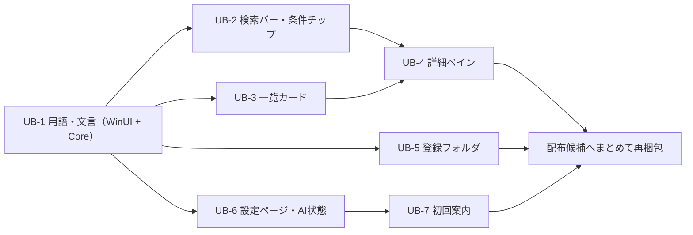

# UI ブラッシュアップ計画（2026-11-18）

> 対象：WinUI 3 製品GUI（`src/Aredoko.WinUI`）／基準：HEAD `ad9691a`・`frontend-product22`・候補23
> 根拠：[MainPage.xaml](../src/Aredoko.WinUI/MainPage.xaml) ほか WinUI ソース全体の文字列抽出（35字以上の表示文 211 件・ダイアログ部品 153 件）と、
> 受入スクリーンショット `data/gui-ui-polish02/run08_light/*.png`（1280px）の確認。
> 既存の `A01`〜`F06`（62項目・文言改善）とは別系統として、ID は **`UB-`** で始める。

---

## 0. 目的と結論

「機能は揃ったが、**説明文が多く、一目で何がどこにあるか分からない**」状態を解消する。原因は次の4つに集約される。

| # | 原因 | 典型例 |
| --- | --- | --- |
| 1 | **常時表示の説明文**が操作部品と同じ重さで並ぶ | 詳細ペインの「選択した作品をまとめて整理できます。個別のタグや…」、登録画面の「登録後に、一覧だけを取得するか…」 |
| 2 | **同じ情報・操作が重複**している | 件数がヘッダー「3 件」とフッター「読み込み済み 3件（1–3 / 全3件）」に二重、`登録フォルダ` が左ナビとヘッダーに二重、タグがバッジ「#背景 +3」と「ほかタグ: 空、キャラクター…」に二重 |
| 3 | **ボタン名が「状態」でなく「行き先」や長文** | `グリッド表示` ボタンはリスト表示中に表示（押すとグリッドになる）、検索方法「名前・タグの意味＋画像の見た目（AI）」 |
| 4 | **用語が揺れている** | スキャン／一覧を更新／ファイル一覧の作成／索引／AI索引／検索用データ、中断／中止／停止／キャンセル、作品／アイテム／候補 |

**方針**：画面は「左＝どこを見るか／上＝何を探すか／中央＝結果／右＝選んだものの操作」の4区画に固定し、
説明文は**ツールチップ・ⓘ「詳しく」・空状態**にだけ置く。ボタンは**アイコン＋短い動詞**、状態は**色付きピル／チップ**で示す。

---

## 1. デザインルール（全項目共通の判断基準）

| ルール | 基準 |
| --- | --- |
| R1 常時表示の説明文 | **主画面・詳細ペインでは原則 0 行**。必要ならツールチップ、ⓘ「詳しく」Flyout、または空状態にだけ置く |
| R2 ラベル長 | 見出し：名詞 2〜8 字／ボタン：動詞 10 字以内／ComboBox 項目：12 字以内（補足はツールチップ） |
| R3 メッセージ | **1 文・30 字以内＋次の操作ボタン**。「〜を確認してください」より押せるボタン（［再検索］［AIを設定］）を出す |
| R4 アイコン | 主要操作・ナビ・種類には Segoe Fluent Icons を付ける。**同じアイコンを別機能に使わない**（現状：棚と登録フォルダが両方 Folder） |
| R5 状態表示 | トグルは「現在の状態」を表示（セグメント／選択状態）。進捗・警告は色付きピル（情報=Attention／成功=Success／注意=Caution／失敗=Critical） |
| R6 条件の見える化 | 種類・タグ・棚・フォルダ範囲・類似検索は**1行の「条件チップ」**に並べ、各チップの × で解除、［すべて解除］で一括解除 |
| R7 保存 | 未保存がある時だけ保存バーを出す。保存済みの時に無効ボタン＋「保存済み」を常時表示しない |
| R8 安全 | 原本・登録解除・記録削除・取消競合の**安全確認は文言を短くしても省略しない**（同意チェックは確認ダイアログへ置換可） |
| R9 互換 | 既存 `AutomationId`・設定キー・`SearchMethod` 0..9 の順序・`content.Children[0]=Image` 等のテスト前提は維持。文言依存テストは同時に更新（§7） |

### 1.1 用語の統一

| 統一後 | 置き換える揺れ | 使い分け |
| --- | --- | --- |
| **作品** | アイテム、ファイル（一覧の対象として）、候補（文字検索時） | 一覧に並ぶ対象 |
| **ファイル** | 元ファイル以外の「作品」の意味での使用 | ディスク上の実体・パス・保存場所 |
| **候補** | — | **AI 検索結果に限定** |
| **ファイル一覧を更新**（名詞：ファイル一覧） | スキャン、一覧を作る、ファイル一覧の作成・更新、走査 | フォルダ内のファイルを読み込む処理 |
| **AI検索データ** | 索引、AI索引、検索用データ、AI検索用データ、インデックス | AI 検索のために作るデータ。動詞は「作成／更新」 |
| **AIを確認中** | AI環境の整合性を検証中、照合 | 起動時のファイル検証 |
| **AIを起動中** | AIモデルを読み込み中、メモリに準備 | 初回検索時のモデル読み込み |
| **AI実行環境** | 実行環境、AI環境、ランタイム | — |
| **AIタグ候補** | 未承認タグ、未承認タグ候補、タグ候補 | — |
| **中止** | 中断、停止、キャンセル（処理を止める意味） | 「キャンセル」はダイアログを閉じる意味だけに使う |
| **解除** | 範囲を解除、条件を解除、絞り込みを解除、選択を解除 | 条件チップの × と［すべて解除］ |
| **自動で入れる棚** | 初期棚、新しく見つけた作品を入れる棚 | — |
| **一致した理由** | 検索の根拠 | — |

---

## 2. 画面レイアウトの改善（修正前 → 修正後）

### 2.1 メイン画面（検索・一覧）

````carousel
```text
修正前（1280px・現行）
┌──┬──────────────────────────────────────────────────┬─────────────────┐
│≡ │ [←][→] ライブラリ     3件 [グリッド表示][👁表示サイズ][▯詳細][登録フォルダ] │ 詳細と整理    [×] │
│  │ [名前・タグを検索（Ctrl+F）][すべての種類▾][名前・タグの文字▾][タグで絞り込む][🔍検索]│ card_beta.png    │
│📚すべて│ （条件があると：検索する場所…[範囲を解除] / [棚一覧] 棚… [棚を変更…][解除]    │ ☐ ★ お気に入り   │
│☆お気に入り│   / #タグ [×] / 『X』に似た作品 [元の検索に戻る] が別々の行で増える）  │ [画像を大きく表示] │
│🕘閲覧履歴│ ┌────────────────────────────────────────┐ │ [似た画像・素材を探す]│
│📁棚    │ │🖼 card_alpha.png  [画像][棚:整理棚Alpha][#背景 +3]│ │ [このタグで絞り込む(2件)…]│
│📁登録フォルダ│ │   ほかタグ: 空、キャラクター、青                 │ │ [AIタグ候補]      │
│  │ │   プレビューなし                               │ │ タグ [空, 夜景     ] │
│  │ └────────────────────────────────────────┘ │ (#空×)(#夜景×)     │
│  │                                                    │ [一覧からタグを追加] │
│  │                                                    │ 棚 [整理棚Beta][変更][開く]│
│⚙設定│ 読み込み済み 3件（1–3 / 全3件）        1件選択 [一覧の操作] │ 保存済み [変更を保存](無効)│
└──┴──────────────────────────────────────────────────┴─────────────────┘
```
<!-- slide -->
```text
修正後（1280px）
┌──────────┬────────────────────────────────────────────┬──────────────────┐
│ 🏠 すべて    │ [🔍 名前・タグで検索（Ctrl+F）                 ][検索] [文字│AI▾] │ ┌──────────────┐ │
│ ★ お気に入り │ [すべて][📖本][🖼画像][🎬動画][🎵音声][🗜圧縮][🧩素材]  [🏷タグ▾]  │ │   プレビュー     │ │
│ 🕘 閲覧履歴  │ 条件：(🏷 夜景 ×)(📚 整理棚Beta ×)(📁 2フォルダ ×) [すべて解除]  │ └──────────────┘ │
│ 📚 棚       │ すべての作品 · 3件                        [☰│▦] [🔍±] [▯]    │ card_beta.png   ★ │
│ 📁 登録フォルダ│ ┌──────────────────────────────────────┐ │ [▶ 画像を開く] [≈][⋯]│
│            │ │🖼 card_alpha.png         ★                 │ │ タグ          ✨候補│
│            │ │  [画像] [📚整理棚Alpha] [#背景][#空][#青] +1   │ │ (#空×)(#夜景×) [+追加]│
│            │ └──────────────────────────────────────┘ │ 棚  (📚整理棚Beta) [変更]│
│ ────────── │                                              │ ▸ ファイル情報      │
│ 🤖 AI：未設定 │                                              │                  │
│ ⚙ 設定      │ ⟳ AIを確認中 45%（1.2/3.4 GB）          [⋯ その他]     │ ●未保存 [保存][元に戻す]│
└──────────┴────────────────────────────────────────────┴──────────────────┘
```
````

| 区画 | 変更点 |
| --- | --- |
| 左ナビ | 棚＝📚（Library）、登録フォルダ＝📁（Folder）で**アイコン重複を解消**。すべて＝🏠。下部に **AI 状態ピル**（未設定／確認中／使用可／要確認）を置き、クリックで AI 設定へ。設定は最下段のまま |
| 1行目 | 検索欄＋［検索］＋**検索方法（文字│AI）**。ヘッダーの［登録フォルダ］は左ナビと重複するため削除 |
| 2行目 | 種類 ComboBox を**アイコン付き種類チップ**（単一選択）に変更。［タグで絞り込む］は🏷ドロップダウンとして同列 |
| 3行目 | `ActiveSearchScopeBar`・`ShelfScopeBar`・`TagScopeBar`・`SimilarityBar` の4行を**1行の条件チップ**へ統合。条件なしの時は行ごと非表示 |
| 4行目 | 画面名・件数・表示切替。［グリッド表示］文字ボタン → **☰│▦ セグメント**（現在の状態が選択表示）。表示サイズ・詳細はアイコンボタン＋ツールチップ |
| フッター | 「読み込み済み」＋件数の二重表示をやめ、**全件読み込み済みなら非表示**、部分読み込み時のみ「1–100 / 2,345件」。AI 確認中バー（`RuntimeVerifyCard`）は同じ行に1行ピルで統合。［一覧の操作］→［⋯ その他］ |

### 2.2 一覧カード

| 修正前 | 修正後 |
| --- | --- |
| 種類バッジ「画像」＋棚「棚:整理棚Alpha」＋「#背景 +3」＋2行目「ほかタグ: 空、キャラクター、青」＋3行目「プレビューなし」 | 1行に **[種類] [📚棚] [#タグ×幅に収まるだけ] +n**。「ほかタグ」行と「プレビューなし」（プレースホルダーアイコンで判別できる）を削除。お気に入りは右上 ★、元ファイル欠落は ⚠ ピル。読み込み中は「読込中」文字でなく薄いプレースホルダー |

### 2.3 右の詳細ペイン

````carousel
```text
修正前
詳細と整理                [×]
card_beta.png
☐ ★ お気に入り
[      画像を大きく表示      ]   ← アクセント
[     似た画像・素材を探す    ]
[ このタグで絞り込む（2 件）… ]
[AIタグ候補]
タグ
[空, 夜景                    ]
(#空×)(#夜景×)
[     一覧からタグを追加     ]
棚
[整理棚Beta    ][変更][開く]
▸ ファイルのプロパティ

保存済み
[        変更を保存（無効）       ]
```
<!-- slide -->
```text
修正後
┌──────────────────────┐ [×]
│      プレビュー（大）       │
└──────────────────────┘
card_beta.png                 ★
画像 · 1.2 MB · 2026/11/02
[▶ 画像を開く] [≈ 似たもの] [⋯]
                         └ 保存場所を開く / パスをコピー
タグ                     [✨ AI候補]
(#空 ×) (#夜景 ×)  [+ タグを追加]
   └ チップをクリック＝このタグで絞り込み
棚
(📚 整理棚Beta)          [変更]
   └ チップをクリック＝その棚を開く
▸ ファイル情報
▸ 一致した理由（検索時のみ）

（未保存がある時だけ表示）
● 未保存の変更  [保存] [元に戻す]
```
````

- タイトル「詳細と整理」は削除し、**ファイル名を見出し**にする。プレビューを最上段・大きく（160px → ペイン幅いっぱい）。
- お気に入りはチェックボックス → 見出し横の **★ トグル**（即時保存はツールチップで伝える）。
- 「このタグで絞り込む（n件）…」「開く（棚）」の独立ボタンは、**チップのクリック動作**に統合。
- 「一覧からタグを追加」は［+ タグを追加］の入力候補（既存タグ候補）に統合。
- 複数選択時は説明文を削除し、「**3件選択中**」＋アイコン付きボタン（★追加／☆解除／📚棚に追加／棚から外す／選択解除）だけにする。

### 2.4 登録フォルダ画面

```text
修正後
登録フォルダ · 5件            [＋ フォルダを追加]（アクセント）
[🔎 フォルダ名・パスで絞り込み      ] [登録中▾] [☰│▦]
（選択時だけ出る操作バー）2フォルダ選択中 [🔍 このフォルダで検索][⚙ 設定][登録を解除…][×]
┌────────────────────────────────────┐
│ 📁 Pictures   C:\…\Pictures   1,234件 · 更新 11/17  ★ [📂][⚙][⋯] │
└────────────────────────────────────┘
                 ⋯ = 再登録 / 記録を削除…（危険操作は ⋯ の中）
（フォルダが0件の時）ここにフォルダをドロップ、または［＋ フォルダを追加］
```

- 常時表示の「フォルダを選ぶと、まとめて検索や設定ができます。」を削除し、**選択時だけ操作バー**を表示。
- 追加パネルは「フォルダ（パス）［参照…］／☑ サブフォルダを含める／▸ 詳細設定／［追加］［キャンセル］」の最小構成。
- フォルダ設定（右ペイン）は「一覧の更新」「除外」「自動で入れる棚」「起動時の自動更新」「登録の解除」の5見出しに統一し、各説明文はツールチップへ。
- 登録解除の「同意チェック＋ボタン」は［登録を解除…］→**確認ダイアログ**に置換（安全確認は維持：R8）。

### 2.5 設定・AI 準備

| 修正前 | 修正後 |
| --- | --- |
| 640px 程度の `ContentDialog` に全項目が縦スクロールで入り、ボタン名が切れる（「AIのダウンロードキャッシュ」「すべての閲覧履歴を削除…」）。各ツールはさらに別ダイアログ（AIで探す方法／AI検索を設定／AI環境の追加と配置／自動セットアップ／ダウンロード／診断情報／復元の手順）を開き、「設定へ戻る」で往復 | **設定を主画面内のページ化**（左ナビ「設定」→ 中央に表示、右ペインは閉じる）。左に分類タブ「一般／ライブラリ／AI検索／バックアップ／詳細」。各項目は **行カード（アイコン・名前・1行説明・右端に操作）**。テーマ等の単純設定は**即時反映**し、「変更を保存」＋未保存3択バーを廃止 |
| AI の状態が分散した長文（「AI検索には検索モデルと実行環境が必要です。モデル選択や保存先の変更は再起動で反映されます…」） | AI検索ページ先頭に**状態カード**：`① AI実行環境 ✓ ／ ② 検索モデル ✓ ／ ③ AI検索データ 1,234/2,000件` の3ステップ表示＋**次にやること1つだけ**のアクセントボタン（例：［自動セットアップ］［AI検索データを作成］［再起動して反映］）。詳細はその下の折り畳み |

> [!NOTE]
> 設定のページ化は新しい依存（CommunityToolkit の SettingsCard 等）を追加せず、既存スタイル（`AredokoSurfaceStyle`）と Grid で行カードを組む。各ツールの中身（AI 環境・ダウンロード・バックアップ等）は**既存ダイアログ実装を再利用**し、入口と戻り導線だけを変える。

---

## 3. 文言・項目の修正対照表

**種別**：`短縮`＝文を短く／`削除`＝表示しない（必要なら他で代替）／`移動`＝ツールチップ・ⓘ「詳しく」へ／`改名`＝名前変更／`統合`＝他の部品へまとめる／`アイコン化`＝アイコン＋ツールチップ。
［ ］はボタンを表す。行番号は HEAD `ad9691a` 時点。

### 3.1 ヘッダー・検索バー（`MainPage.xaml`）

| ID | 場所 | 種別 | 修正前 | 修正後 |
| --- | --- | --- | --- | --- |
| UB-S01 | [xaml:181](../src/Aredoko.WinUI/MainPage.xaml#L181) | 改名 | ライブラリ | 選択中のナビ名（すべての作品／お気に入り／閲覧履歴…）＋「· 3件」 |
| UB-S02 | [xaml:184](../src/Aredoko.WinUI/MainPage.xaml#L184) | 統合 | 3 件（ヘッダー）＋フッター件数 | 見出し横の「· 3件」に一本化 |
| UB-S03 | [xaml:186](../src/Aredoko.WinUI/MainPage.xaml#L186) | アイコン化 | ［グリッド表示］／［リスト表示］（押した後の状態を表示） | ☰│▦ セグメント（現在の表示を選択状態で表示）。ツールチップ「リスト表示」「グリッド表示」 |
| UB-S04 | [xaml:187-188](../src/Aredoko.WinUI/MainPage.xaml#L187-L188) | アイコン化 | ［👁 表示サイズ］ | ［🔍±］ツールチップ「表示サイズ（Ctrl＋ホイール）」 |
| UB-S05 | [xaml:191](../src/Aredoko.WinUI/MainPage.xaml#L191) | 短縮 | アイテムの表示サイズ | 表示サイズ |
| UB-S06 | [xaml:202](../src/Aredoko.WinUI/MainPage.xaml#L202) | 削除 | 一覧上で Ctrl＋ホイールでも変更できます。 | （UB-S04 のツールチップへ統合） |
| UB-S07 | [xaml:206](../src/Aredoko.WinUI/MainPage.xaml#L206) | アイコン化 | ［▯ 詳細］ | ［▯］トグル。ツールチップ「詳細パネル」 |
| UB-S08 | [xaml:208](../src/Aredoko.WinUI/MainPage.xaml#L208) | 削除 | ［📁 登録フォルダ］（左ナビと重複） | 削除（左ナビ「登録フォルダ」に一本化） |
| UB-S09 | [MainPage.xaml.cs:2291](../src/Aredoko.WinUI/MainPage.xaml.cs#L2291) | 削除 | ［作品一覧へ戻る］（登録フォルダ画面で同ボタンが変化） | 削除（左ナビ／戻るボタンで戻る） |
| UB-S10 | [xaml:212](../src/Aredoko.WinUI/MainPage.xaml#L212) | 短縮 | 名前・タグを検索（Ctrl+F） | 検索方法で切替：文字＝「名前・タグで検索（Ctrl+F）」／AI＝「覚えている内容を文章で（例：夕焼けの海）」 |
| UB-S11 | [xaml:214](../src/Aredoko.WinUI/MainPage.xaml#L214) | 改名 | ComboBox：すべての種類／本／画像／動画／音声・音楽／圧縮ファイル／素材 | 種類チップ：すべて／📖本／🖼画像／🎬動画／🎵音声／🗜圧縮／🧩素材（圧縮のツールチップ「ZIP・CBZ」維持） |
| UB-S12 | [xaml:215](../src/Aredoko.WinUI/MainPage.xaml#L215) | 短縮 | 名前・タグの文字 | 名前・タグ |
| UB-S13 | 同上 | 短縮 | 名前・タグの意味＋画像の見た目（AI） | AIおまかせ（ツールチップ「言葉の意味＋見た目」） |
| UB-S14 | 同上 | 短縮 | 画像の見た目（AI） | 見た目（AI） |
| UB-S15 | 同上 | 短縮 | 名前・タグの意味（AI） | 言葉の意味（AI） |
| UB-S16 | 同上 | 改名 | 未承認タグの文字 | AIタグ候補（文字） |
| UB-S17 | 同上 | 維持 | ページ内の文字 | ページ内の文字 |
| UB-S18 | 同上 | 改名 | 未承認タグの意味（AI） | AIタグ候補（AI） |
| UB-S19 | 同上 | 短縮 | 音声・音楽（AI） | 音声（AI） |
| UB-S20 | 同上 | 改名 | 動画の映像（AI） | 動画の場面（AI） |
| UB-S21 | 同上 | 改名 | 動画内の音（AI） | 動画の音（AI） |
| UB-S22 | 同上（構成） | 統合 | 10項目を1つの ComboBox に混在 | 第1段階：上記短縮＋AI項目で未準備のものに「（未準備）」表示。第2段階（要判断 §8）：［文字│AI▾］の2段選択（内部 0..9 は維持） |
| UB-S23 | [xaml:216](../src/Aredoko.WinUI/MainPage.xaml#L216) | アイコン化 | ［タグで絞り込む］ | ［🏷 タグ▾］ツールチップ「よく使われるタグで絞り込む」 |
| UB-S24 | [xaml:217](../src/Aredoko.WinUI/MainPage.xaml#L217) | 統合 | ［条件を解除］ | 条件チップ行の［すべて解除］ |
| UB-S25 | [xaml:220](../src/Aredoko.WinUI/MainPage.xaml#L220) | 改名 | ［中断］ | ［中止］ |
| UB-S26 | [xaml:230-231](../src/Aredoko.WinUI/MainPage.xaml#L230-L231) | 統合 | 検索する場所…［範囲を解除］ | チップ「📁 2フォルダ ×」 |
| UB-S27 | [xaml:256-259](../src/Aredoko.WinUI/MainPage.xaml#L256-L259) | 統合 | ［棚一覧］ 棚名…［棚を変更…］［解除］ | チップ「📚 整理棚Beta ×」（クリックで棚を変更） |
| UB-S28 | [xaml:249-250](../src/Aredoko.WinUI/MainPage.xaml#L249-L250) | 統合 | #タグ［×］（独立行） | チップ「🏷 夜景 ×」 |
| UB-S29 | [xaml:263-264](../src/Aredoko.WinUI/MainPage.xaml#L263-L264) | 統合 | 『X』に似た作品… ［元の検索に戻る］ | チップ「≈ 『X』に似た作品 ×」（× で元の検索へ。ツールチップに現行説明） |
| UB-S30 | [xaml:233](../src/Aredoko.WinUI/MainPage.xaml#L233) | 改名 | AI検索結果の絞り込み（常時の Expander） | AI 検索時だけ出る［⚙ 候補の表示▾］Flyout |
| UB-S31 | [xaml:236](../src/Aredoko.WinUI/MainPage.xaml#L236) | 短縮 | 単一フォルダで素早く切替（サブフォルダを含む） | フォルダ |
| UB-S32 | [xaml:237](../src/Aredoko.WinUI/MainPage.xaml#L237) | 短縮 | 未確認のアイテムだけを表示 | 未確認の作品だけ |
| UB-S33 | [xaml:238](../src/Aredoko.WinUI/MainPage.xaml#L238) | 短縮 | 名前・タグに検索語がすべて含まれる候補だけ | 検索語を含む候補だけ（ツールチップに全文） |
| UB-S34 | [xaml:239](../src/Aredoko.WinUI/MainPage.xaml#L239) | 短縮 | 上位候補に含める類似度（空欄＝自動） | 類似度のしきい値（プレースホルダー「自動」） |
| UB-S35 | [xaml:240](../src/Aredoko.WinUI/MainPage.xaml#L240) | 短縮 | 上位の類似候補／その他の参考候補／すべてのAI候補 | 上位／参考／すべて |
| UB-S36 | [xaml:241](../src/Aredoko.WinUI/MainPage.xaml#L241)・[xaml.cs:1772-1779](../src/Aredoko.WinUI/MainPage.xaml.cs#L1772-L1779) | 移動 | 検索方法ごとの説明文（例：「動画内の音や会話の特徴を文章で探します。「設定 → AI検索を設定 → 動画内の音」で検索用データを作成してください（先頭トラック対象・文字起こしなし）。」ほか8件） | 常時表示しない。各検索方法項目のツールチップ＋未準備時は空状態の［作成する］ボタン |
| UB-S37 | [xaml:40-44](../src/Aredoko.WinUI/MainPage.xaml#L40-L44) 左ナビ | アイコン化 | すべて=Library／棚=Folder／登録フォルダ=Folder | すべて=Home／棚=Library／登録フォルダ=Folder（重複解消） |
| UB-S38 | 左ナビ下部（新規） | 新規 | （AI 状態は検索時の長文でのみ判明） | AI 状態ピル「🤖 AI：未設定／確認中 45%／使用可／要確認」→ クリックで AI 設定 |

### 3.2 一覧・選択・フッター

| ID | 場所 | 種別 | 修正前 | 修正後 |
| --- | --- | --- | --- | --- |
| UB-L01 | [xaml.cs:670](../src/Aredoko.WinUI/MainPage.xaml.cs#L670) | 削除 | ほかタグ: 空、キャラクター、青 | 削除（バッジ行に幅いっぱいまでタグを並べ、残りを「+n」） |
| UB-L02 | [xaml.cs:748](../src/Aredoko.WinUI/MainPage.xaml.cs#L748)・[798](../src/Aredoko.WinUI/MainPage.xaml.cs#L798) | 削除 | プレビューなし／読込中 | 文字は出さない（プレースホルダーアイコン／薄いプレート） |
| UB-L03 | [xaml.cs:701](../src/Aredoko.WinUI/MainPage.xaml.cs#L701) | アイコン化 | 棚:整理棚Alpha | 📚 整理棚Alpha |
| UB-L04 | カード（新規） | 新規 | お気に入り・欠落は詳細を開くまで不明 | カード右上 ★／⚠「ファイルなし」ピル |
| UB-L05 | [xaml:277](../src/Aredoko.WinUI/MainPage.xaml#L277)・[403](../src/Aredoko.WinUI/MainPage.xaml#L403) | 統合 | ［まとめて整理］→右ペインで操作 | 選択バーに直接［★ お気に入り］［📚 棚に追加］［× 選択解除］ |
| UB-L06 | [xaml:279](../src/Aredoko.WinUI/MainPage.xaml#L279) | 短縮 | ［選択の準備を中止］ | ［中止］ |
| UB-L07 | [xaml:416-417](../src/Aredoko.WinUI/MainPage.xaml#L416-L417)・[xaml.cs:596](../src/Aredoko.WinUI/MainPage.xaml.cs#L596) | 統合 | 読み込み済み 3件（1–3 / 全3件） | 全件読み込み時は非表示。部分時のみ「1–100 / 2,345件」 |
| UB-L08 | [xaml:419](../src/Aredoko.WinUI/MainPage.xaml#L419) | アイコン化 | ［一覧の操作］ | ［⋯ その他］ |
| UB-L09 | [xaml:421](../src/Aredoko.WinUI/MainPage.xaml#L421) | 短縮 | 前の範囲を読み込む | 前の範囲へ |
| UB-L10 | [xaml:422](../src/Aredoko.WinUI/MainPage.xaml#L422) | 短縮 | 次の範囲を読み込む | 次の範囲へ |
| UB-L11 | [xaml:424](../src/Aredoko.WinUI/MainPage.xaml#L424)・[Selection.cs:67](../src/Aredoko.WinUI/MainPage.Selection.cs#L67) | 短縮 | 読み込み済みの作品をすべて選択（上限 256 件） | 表示中をすべて選択（最大256件） |
| UB-L12 | [xaml:425](../src/Aredoko.WinUI/MainPage.xaml#L425)・[Selection.cs:72](../src/Aredoko.WinUI/MainPage.Selection.cs#L72) | 短縮 | 読み込み済みの先頭 256 件を選択 | 先頭256件を選択 |
| UB-L13 | [xaml:426](../src/Aredoko.WinUI/MainPage.xaml#L426)・[Selection.cs:84](../src/Aredoko.WinUI/MainPage.Selection.cs#L84)・[xaml.cs:981](../src/Aredoko.WinUI/MainPage.xaml.cs#L981) | 短縮・統一 | 直前の選択からここまで選択（n 件・上限 256 件）／選択起点からここまで選択（…） | ここまで範囲選択（n件）※2種の表記を統一 |
| UB-L14 | [xaml:428](../src/Aredoko.WinUI/MainPage.xaml#L428) | 改名 | 接続と一覧を更新 | 最新の状態に更新 |
| UB-L15 | [Selection.cs:26](../src/Aredoko.WinUI/MainPage.Selection.cs#L26) | 短縮 | 現在の表示範囲外で n 件を選択中 | 表示外に n件選択中 |
| UB-L16 | [Selection.cs:47](../src/Aredoko.WinUI/MainPage.Selection.cs#L47)・[57](../src/Aredoko.WinUI/MainPage.Selection.cs#L57) | 短縮 | n 件を選択しています。 | n件選択中 |
| UB-L17 | [Selection.cs:159](../src/Aredoko.WinUI/MainPage.Selection.cs#L159) | 短縮 | 一括整理は一度に 256 件まで | 一度に256件まで |

### 3.3 空状態・検索結果メッセージ（`MainPage.xaml.cs` ほか）

> [!TIP]
> 長い説明は**ステータスの ⓘ「詳しく」Flyout（既存 `StatusExplanation`）に残す**。表示面は「1文＋ボタン」にする。

| ID | 場所 | 種別 | 修正前 | 修正後 |
| --- | --- | --- | --- | --- |
| UB-M01 | [xaml:285](../src/Aredoko.WinUI/MainPage.xaml#L285) | 短縮 | フォルダを登録すると、ここに作品が並びます。 | まだ作品がありません ［＋ フォルダを追加］ |
| UB-M02 | [xaml:287](../src/Aredoko.WinUI/MainPage.xaml#L287) | 短縮 | ［AIの準備へ］ | ［AIを準備］ |
| UB-M03 | [xaml:288](../src/Aredoko.WinUI/MainPage.xaml#L288) | 短縮 | ［ファイル名・タグで探す］ | ［名前・タグで探す］ |
| UB-M04 | [xaml:290](../src/Aredoko.WinUI/MainPage.xaml#L290) | 短縮 | ［検索・絞り込みを解除して表示］ | ［条件をすべて解除］ |
| UB-M05 | [xaml.cs:436](../src/Aredoko.WinUI/MainPage.xaml.cs#L436) | 短縮 | 検索結果を準備しています… | 検索中… |
| UB-M06 | [xaml.cs:549](../src/Aredoko.WinUI/MainPage.xaml.cs#L549)・[564](../src/Aredoko.WinUI/MainPage.xaml.cs#L564) | 短縮 | 中断しました／検索を中断しました。もう一度「検索」を押してください。 | 検索を中止しました ［再検索］ |
| UB-M07 | [xaml.cs:470](../src/Aredoko.WinUI/MainPage.xaml.cs#L470) | 短縮 | ページ内の文字を入力して検索してください（抽出済みのページ本文が検索対象です）。 | ページ内の文字を入力してください |
| UB-M08 | [xaml.cs:471](../src/Aredoko.WinUI/MainPage.xaml.cs#L471) | 短縮 | 検索用データがある未承認タグ候補がありません。設定の「AI検索を設定」で検索用データを作成してください。 | AIタグ候補のAI検索データがありません ［作成する］ |
| UB-M09 | [xaml.cs:472](../src/Aredoko.WinUI/MainPage.xaml.cs#L472) | 短縮 | この範囲に一致する未承認のAIタグ候補はありません。作品の詳細「AIタグ候補」から候補を生成・確認できます。 | 該当するAIタグ候補はありません |
| UB-M10 | [xaml.cs:473](../src/Aredoko.WinUI/MainPage.xaml.cs#L473) | 短縮 | この範囲に音声データ作成済みの動画がありません。設定の「AI検索を設定」→「動画内の音」から検索用データを作成してください。 | 動画の音のAI検索データがありません ［作成する］ |
| UB-M11 | [xaml.cs:480](../src/Aredoko.WinUI/MainPage.xaml.cs#L480) | 短縮 | 参考候補の区切りがありません。「すべてのAI候補」を選ぶか、画像の見た目／名前・タグの意味（AI）で区切りを指定してください。 | 参考候補はありません ［すべて表示］ |
| UB-M12 | [xaml.cs:481](../src/Aredoko.WinUI/MainPage.xaml.cs#L481) | 短縮 | 区切り以上の候補はありません。上位候補に含める類似度を下げるか、表示する候補を切り替えてください。 | しきい値以上の候補はありません ［すべて表示］ |
| UB-M13 | [xaml.cs:483](../src/Aredoko.WinUI/MainPage.xaml.cs#L483) | 短縮 | 名前・タグに一致する作品はありません。検索語や絞り込み条件を変更してください。 | 一致する作品はありません ［条件をすべて解除］ |
| UB-M14 | [xaml.cs:485](../src/Aredoko.WinUI/MainPage.xaml.cs#L485) | 移動 | 抽出・保存済みのページ本文が検索対象です（同じページ内に…）。「本を開く」で先頭の一致ページへ移動できます。 | 表示面：「ページ内一致 n冊」。全文は ⓘ詳しく |
| UB-M15 | [xaml.cs:486](../src/Aredoko.WinUI/MainPage.xaml.cs#L486) | 移動 | 未承認の英語タグ候補を含むデータから、言葉の意味が近い作品を表示しています。…類似度は正解率ではありません。… | 表示面：「AIタグ候補（AI） n件」。全文は ⓘ詳しく |
| UB-M16 | [xaml.cs:487](../src/Aredoko.WinUI/MainPage.xaml.cs#L487) | 移動 | 最新の生成履歴に未承認の候補がある作品を表示しています。…承認・却下できます。 | 表示面：「AIタグ候補あり n件」。全文は ⓘ詳しく |
| UB-M17 | [xaml.cs:488-490](../src/Aredoko.WinUI/MainPage.xaml.cs#L488-L490) | 移動 | 検索用データがある動画内の音を、内容や音の特徴から探します。…（3件） | 表示面：「動画の音 n件 · 一致位置から再生できます」。全文は ⓘ詳しく |
| UB-M18 | [xaml.cs:491](../src/Aredoko.WinUI/MainPage.xaml.cs#L491) | 移動 | AI検索の候補です。…検索用データがある作品を類似順に表示します。…類似度・順位統合値は正解率ではありません。… | 表示面：「AI候補 n件（上位 a · 参考 b）」。全文は ⓘ詳しく |
| UB-M19 | [xaml.cs:492](../src/Aredoko.WinUI/MainPage.xaml.cs#L492) | 移動 | 探したい内容を文章で入力してください。初回の設定は左下の「設定」→「AI検索を設定」から行えます。 | 検索欄のプレースホルダー（UB-S10）。AI未設定時は左下 AI ピルで誘導 |
| UB-M20 | [xaml.cs:495-502](../src/Aredoko.WinUI/MainPage.xaml.cs#L495-L502) | 維持・短縮 | 未承認タグ候補 · 更新が必要: n件／動画内の音候補 n件 · 準備済み m件 ほか | AIタグ候補 · 要更新 n件／動画の音 n件 · 準備済み m件（用語統一のみ） |
| UB-M21 | [xaml.cs:511](../src/Aredoko.WinUI/MainPage.xaml.cs#L511) | 短縮 | この範囲の作品はまだAI検索用データが作成されていません（対象 n件）。設定の「AI検索を設定」から作成してください。 | AI検索データが未作成です（対象 n件）［作成する］ |
| UB-M22 | [xaml.cs:513](../src/Aredoko.WinUI/MainPage.xaml.cs#L513) | 短縮 | この範囲に準備済みの類似候補はありません。種類・フォルダ・AIの対象範囲を確認してください。 | 候補はありません ［条件をすべて解除］ |
| UB-M23 | [xaml.cs:583](../src/Aredoko.WinUI/MainPage.xaml.cs#L583) | 短縮 | 検索結果が更新されたか、有効期限が切れました。同じ条件で「検索」を押してください。 | 結果の有効期限が切れました ［再検索］ |
| UB-M24 | [xaml.cs:584](../src/Aredoko.WinUI/MainPage.xaml.cs#L584) | 短縮 | 類似検索を完了できませんでした。「元の検索に戻る」か、AIの対象範囲を確認してください。 | 類似検索に失敗しました ［元の検索へ］ |
| UB-M25 | [xaml.cs:585](../src/Aredoko.WinUI/MainPage.xaml.cs#L585) | 短縮 | AI検索にはモデルと実行環境の設定が必要です。\n名前・タグの文字検索と閲覧は、AIなしでも使えます。 | AIが未設定です ［AIを設定］［名前・タグで探す］ |
| UB-M26 | [xaml.cs:586](../src/Aredoko.WinUI/MainPage.xaml.cs#L586) | 短縮 | この条件ではAI検索を利用できません。\n{理由}\n名前・タグの文字検索に切り替えるか、AI設定を確認してください。 | この条件ではAI検索できません ［名前・タグで探す］（理由は ⓘ詳しく） |
| UB-M27 | [xaml.cs:587](../src/Aredoko.WinUI/MainPage.xaml.cs#L587) | 短縮 | 検索を完了できませんでした。検索フォルダや接続状態を確認してください。 | 検索できませんでした ［再試行］ |
| UB-M28 | [xaml.cs:599](../src/Aredoko.WinUI/MainPage.xaml.cs#L599) | 短縮 | タグ「X」に一致する作品はありません。タグの解除や条件の変更をお試しください。 | タグ「X」の作品はありません ［タグを解除］ |
| UB-M29 | [xaml.cs:600](../src/Aredoko.WinUI/MainPage.xaml.cs#L600) | 短縮 | 現在の検索範囲・種類に一致する作品はありません。条件を変更してください。 | 条件に合う作品はありません ［条件をすべて解除］ |
| UB-M30 | [xaml.cs:602](../src/Aredoko.WinUI/MainPage.xaml.cs#L602) | 短縮 | 選択したフォルダに表示できる作品がありません。一覧の更新や接続状態を確認するか、検索範囲を解除してください。 | このフォルダに作品がありません ［範囲を解除］［ファイル一覧を更新］ |
| UB-M31 | [xaml.cs:605](../src/Aredoko.WinUI/MainPage.xaml.cs#L605)・[606](../src/Aredoko.WinUI/MainPage.xaml.cs#L606) | 短縮 | お気に入りの作品はまだありません。上のお気に入りフォルダを開くか、作品を右クリックして登録できます。／お気に入りはまだありません。作品の右クリックメニューや詳細から登録できます。 | お気に入りはまだありません（補足1行：「★ で追加できます」） |
| UB-M32 | [xaml.cs:607](../src/Aredoko.WinUI/MainPage.xaml.cs#L607) | 短縮 | 作品がありません。登録フォルダの一覧更新や接続状態を確認してください。 | 作品がありません ［登録フォルダへ］ |
| UB-M33 | [xaml.cs:1751](../src/Aredoko.WinUI/MainPage.xaml.cs#L1751) | 維持 | 『X』に似た作品（基準） | 条件チップの表示文として維持 |
| UB-M34 | [xaml.cs:1764](../src/Aredoko.WinUI/MainPage.xaml.cs#L1764) | 短縮 | 画像・表紙の見た目から似た候補を探しています。検索語の入力や「検索」で通常の検索に戻ります。（ほか5種） | 見た目が似た作品／場面が似た動画／音が似た動画／音が似た曲 など（「通常の検索に戻ります」はチップの × で代替し削除） |

### 3.4 状態表示・AI 確認中・通知

| ID | 場所 | 種別 | 修正前 | 修正後 |
| --- | --- | --- | --- | --- |
| UB-N01 | [xaml:409](../src/Aredoko.WinUI/MainPage.xaml#L409)・[xaml.cs:313](../src/Aredoko.WinUI/MainPage.xaml.cs#L313) | 改名 | AI環境の整合性を検証中… | AIを確認中 |
| UB-N02 | [xaml:411](../src/Aredoko.WinUI/MainPage.xaml#L411)・[xaml.cs:316](../src/Aredoko.WinUI/MainPage.xaml.cs#L316) | 短縮 | ファイルを走査しています…／{p}% ({n} / {m} ファイル) | 45%（1.2 / 3.4 GB） |
| UB-N03 | [xaml.cs:268-270](../src/Aredoko.WinUI/MainPage.xaml.cs#L268-L270)・[326-328](../src/Aredoko.WinUI/MainPage.xaml.cs#L326-L328) | 短縮 | AIモデルを読み込み中…／初回検索のためAIモデルをメモリに準備しています… | AIを起動中…（補足：初回のみ時間がかかります） |
| UB-N04 | [xaml.cs:306-309](../src/Aredoko.WinUI/MainPage.xaml.cs#L306-L309) | 短縮 | 照合に時間がかかっています／AI環境の整合性を検証中… {p}% (…) — 5分以上経過しています。完了までそのままお待ちください。 | 時間がかかっています（45%）。そのままお待ちください |
| UB-N05 | [xaml.cs:390-395](../src/Aredoko.WinUI/MainPage.xaml.cs#L390-L395) | 短縮 | AI環境の整合性を検証しています（{p}%）。完了後に自動で検索を開始します…（ほか2件） | AIの確認後に検索します（45%） |
| UB-N06 | [xaml:433](../src/Aredoko.WinUI/MainPage.xaml#L433) | 改名 | 接続準備中 | 起動中… |
| UB-N07 | [xaml:434](../src/Aredoko.WinUI/MainPage.xaml#L434) | 改名 | ［説明］ | ［ⓘ 詳しく］ |
| UB-N08 | [xaml:406-413](../src/Aredoko.WinUI/MainPage.xaml#L406-L413) | 統合 | `RuntimeVerifyCard`（独立バー3列） | フッター行の1行ピル（⟳ AIを確認中 45%）＋左ナビ AI ピルと連動 |
| UB-N09 | [StartupScans.cs:55](../src/Aredoko.WinUI/MainPage.StartupScans.cs#L55) | 短縮 | {d}/{t} フォルダ完了。検索・閲覧はそのまま使えます。 | 起動時の更新 {d}/{t} フォルダ |
| UB-N10 | [StartupScans.cs:70](../src/Aredoko.WinUI/MainPage.StartupScans.cs#L70) | 短縮 | {d}/{t} フォルダ処理済み。一部は未完了です。登録フォルダの状態を確認してください。取得済みの一覧は保持されています。 | 一部のフォルダを更新できませんでした ［登録フォルダへ］ |
| UB-N11 | [xaml:226](../src/Aredoko.WinUI/MainPage.xaml#L226) | 改名 | ［停止］ | ［中止］ |

### 3.5 右の詳細ペイン

| ID | 場所 | 種別 | 修正前 | 修正後 |
| --- | --- | --- | --- | --- |
| UB-D01 | [xaml:53](../src/Aredoko.WinUI/MainPage.xaml#L53)・[xaml.cs:2221](../src/Aredoko.WinUI/MainPage.xaml.cs#L2221) | 削除 | 詳細と整理 | 見出しはファイル名（`ItemTitle`）に置換 |
| UB-D02 | [xaml:61](../src/Aredoko.WinUI/MainPage.xaml#L61) | 削除 | 選択した作品をまとめて整理できます。個別のタグやプレビューは1件だけ選択すると表示します。 | 削除（見出し「3件選択中」で十分） |
| UB-D03 | [xaml:62-66](../src/Aredoko.WinUI/MainPage.xaml#L62-L66) | アイコン化 | ［お気に入りに登録］［お気に入りを解除］［棚に追加…］［棚から外す…］［選択を解除］ | ［★ お気に入りに追加］［☆ お気に入りから外す］［📚 棚に追加］［棚から外す］［× 選択解除］ |
| UB-D04 | [xaml:72](../src/Aredoko.WinUI/MainPage.xaml#L72)・[xaml.cs:463](../src/Aredoko.WinUI/MainPage.xaml.cs#L463) | 短縮 | 作品を選んでください | （中央のアイコン付き空状態）作品を選択してください |
| UB-D05 | [xaml:75](../src/Aredoko.WinUI/MainPage.xaml#L75) | 配置 | プレビュー高さ 160、ファイル名・パスの下 | 最上段・ペイン幅いっぱい |
| UB-D06 | [xaml:76](../src/Aredoko.WinUI/MainPage.xaml#L76) | アイコン化 | ☐ ★ お気に入り（チェックボックス） | 見出し横の ★/☆ トグル（ツールチップ「お気に入り（すぐ保存）」） |
| UB-D07 | [xaml:78](../src/Aredoko.WinUI/MainPage.xaml#L78) | 短縮 | ［画像を大きく表示］ | ［▶ 画像を開く］ |
| UB-D08 | [xaml:79-81](../src/Aredoko.WinUI/MainPage.xaml#L79-L81) | アイコン化 | ［本を開く］［動画を再生］［音声を再生］ | ［▶ 本を開く］［▶ 動画を再生］［▶ 音声を再生］ |
| UB-D09 | [xaml:82](../src/Aredoko.WinUI/MainPage.xaml#L82)・[xaml.cs:1288](../src/Aredoko.WinUI/MainPage.xaml.cs#L1288) | 短縮 | ［似た画像・素材を探す］ | ［≈ 似たもの］（ツールチップ「似た画像・素材を探す」） |
| UB-D10 | [xaml:83](../src/Aredoko.WinUI/MainPage.xaml#L83)・[xaml.cs:1297](../src/Aredoko.WinUI/MainPage.xaml.cs#L1297) | 統合 | ［このタグで絞り込む（n 件）…］ | 削除。タグチップのクリックで絞り込み（ツールチップ「このタグで絞り込む」） |
| UB-D11 | [xaml:87](../src/Aredoko.WinUI/MainPage.xaml#L87) | 改名 | 検索の根拠 | 一致した理由 |
| UB-D12 | [xaml:90](../src/Aredoko.WinUI/MainPage.xaml#L90) | 配置 | ［AIタグ候補］（単独行） | タグ見出し右の［✨ AI候補］ |
| UB-D13 | [xaml:92](../src/Aredoko.WinUI/MainPage.xaml#L92) | 統合 | タグ（カンマ区切りTextBox「例：海, 夕焼け」）＋チップの二重表示 | チップ＋［+ タグを追加］入力（Enterで確定、既存タグを候補表示）。ツールチップ「Enterで追加・Ctrl+Sで保存」 |
| UB-D14 | [xaml:96](../src/Aredoko.WinUI/MainPage.xaml#L96) | 統合 | ［一覧からタグを追加］ | UB-D13 の入力候補へ統合 |
| UB-D15 | [xaml:99-101](../src/Aredoko.WinUI/MainPage.xaml#L99-L101) | 統合 | 棚［整理棚Beta（読み取り専用欄）］［変更］［開く］ | 棚チップ（クリックで開く）＋［変更］ |
| UB-D16 | [xaml:104](../src/Aredoko.WinUI/MainPage.xaml#L104) | 改名 | ファイルのプロパティ | ファイル情報 |
| UB-D17 | [xaml:107-108](../src/Aredoko.WinUI/MainPage.xaml#L107-L108) | 移動 | ［保存場所を開く］［パスをコピー］（折り畳み内） | 開くボタン横の［⋯］にも配置（折り畳み内は維持） |
| UB-D18 | [xaml:113](../src/Aredoko.WinUI/MainPage.xaml#L113)・[xaml.cs:1504](../src/Aredoko.WinUI/MainPage.xaml.cs#L1504) | 短縮 | 保存済み／保存済み・一覧を更新しています… | 保存済み時は非表示、保存直後だけ「✓ 保存しました」 |
| UB-D19 | [xaml:116](../src/Aredoko.WinUI/MainPage.xaml#L116) | 短縮 | ［変更を保存］（常時表示・保存済みでも無効表示） | 未保存時だけ「● 未保存の変更 ［保存］」 |
| UB-D20 | [xaml:117](../src/Aredoko.WinUI/MainPage.xaml#L117) | 短縮 | ［未保存の変更を取り消す］ | ［元に戻す］ |
| UB-D21 | [xaml.cs:1507](../src/Aredoko.WinUI/MainPage.xaml.cs#L1507) | 短縮 | 保存できませんでした。変更内容は残っています。 | 保存できませんでした（編集内容は残っています） |
| UB-D22 | [xaml.cs:1461](../src/Aredoko.WinUI/MainPage.xaml.cs#L1461) | 維持 | 変更を破棄しますか？［変更を破棄］［編集を続ける］ | 維持（安全確認） |
| UB-D23 | [xaml.cs:1232](../src/Aredoko.WinUI/MainPage.xaml.cs#L1232)・[1233](../src/Aredoko.WinUI/MainPage.xaml.cs#L1233) | 短縮 | 元ファイルが見つかりません。登録フォルダの接続やファイルの場所を確認してください。登録済みのタグや棚は残っています。（ほか1件） | ⚠ 元ファイルが見つかりません（タグ・棚は保持） |
| UB-D24 | [xaml.cs:1236](../src/Aredoko.WinUI/MainPage.xaml.cs#L1236) | 短縮 | この形式はアプリ内で開けません。「ファイルのプロパティ」から保存場所を開けます。 | アプリ内では開けない形式です ［保存場所を開く］ |
| UB-D25 | [xaml.cs:1247](../src/Aredoko.WinUI/MainPage.xaml.cs#L1247)・[1254](../src/Aredoko.WinUI/MainPage.xaml.cs#L1254) | 短縮 | 一致した n ページを開きます。元ファイルが変わっていた場合は、読書位置を復元します。／一致した mm:ss から再生します（再生可能な範囲内）。 | nページ目を開きます／mm:ss から再生します |
| UB-D26 | [xaml.cs:1205](../src/Aredoko.WinUI/MainPage.xaml.cs#L1205) | 短縮 | 承認後のタグを確認できません。AIタグ候補を開き直してください。 | タグを確認できません ［AI候補を開き直す］ |
| UB-D27 | [xaml.cs:1582](../src/Aredoko.WinUI/MainPage.xaml.cs#L1582) | 短縮 | 読み込み済みの作品で多いタグ | よく使われるタグ |
| UB-D28 | [xaml.cs:1574](../src/Aredoko.WinUI/MainPage.xaml.cs#L1574) | 維持 | タグ絞り込みを解除 | タグの絞り込みを解除 |

### 3.6 右クリックメニュー（作品）

| ID | 場所 | 種別 | 修正前 | 修正後 |
| --- | --- | --- | --- | --- |
| UB-C01 | 全体 | 構成 | 項目がフラットに並ぶ | 「開く／詳細」→「似たものを探す」→「お気に入り・棚」→「ファイル（保存場所・パス）」→「AI」→「削除系」の順に区切り線＋アイコン |
| UB-C02 | [xaml.cs:930](../src/Aredoko.WinUI/MainPage.xaml.cs#L930) | 改名 | 詳細 | 詳細を表示 |
| UB-C03 | [xaml.cs:992](../src/Aredoko.WinUI/MainPage.xaml.cs#L992) | 短縮 | この作品の閲覧履歴を削除… | 履歴から削除… |
| UB-C04 | [xaml.cs:1002](../src/Aredoko.WinUI/MainPage.xaml.cs#L1002) | 改名 | 本のページをAI検索に追加… | ページをAI検索データに追加… |
| UB-C05 | [xaml.cs:1004](../src/Aredoko.WinUI/MainPage.xaml.cs#L1004) | 改名 | 複数の本をAI検索に追加… | 複数の本をAI検索データに追加… |
| UB-C06 | [xaml.cs:1012](../src/Aredoko.WinUI/MainPage.xaml.cs#L1012) | 短縮 | ファイルのパスをコピー | パスをコピー |
| UB-C07 | [xaml.cs:1023](../src/Aredoko.WinUI/MainPage.xaml.cs#L1023)・[1028](../src/Aredoko.WinUI/MainPage.xaml.cs#L1028)・[1036](../src/Aredoko.WinUI/MainPage.xaml.cs#L1036) | 統合 | 内容が似た動画を探す／音が似た動画を探す／内容が似た音声・曲を探す | サブメニュー「≈ 似たものを探す ▸ 場面が似た動画／音が似た動画／似た曲」 |
| UB-C08 | [xaml.cs:1030](../src/Aredoko.WinUI/MainPage.xaml.cs#L1030) | 移動 | 準備済みの動画内音声の索引を使います。映像・音声ファイルの類似検索とは別です。 | ツールチップのみ（用語：AI検索データ） |

### 3.7 初回案内・使い方（`MainPage.xaml`／`MainPage.GettingStarted.cs`）

| ID | 場所 | 種別 | 修正前 | 修正後 |
| --- | --- | --- | --- | --- |
| UB-G01 | [xaml:295](../src/Aredoko.WinUI/MainPage.xaml#L295) | 維持 | どのフォルダを探しますか？ | 維持 |
| UB-G02 | [xaml:296](../src/Aredoko.WinUI/MainPage.xaml#L296)・[GettingStarted.cs:25](../src/Aredoko.WinUI/MainPage.GettingStarted.cs#L25) | 短縮 | 探したいフォルダを追加すると、ファイル一覧を作って名前・タグで探せます（AIなしで使えます）。 | フォルダを追加すると、すぐ名前・タグで探せます |
| UB-G03 | [xaml:299-302](../src/Aredoko.WinUI/MainPage.xaml#L299-L302) | 構成 | はじめ方（3ステップ）＋「1. フォルダを追加 — 探す場所を覚えます」等の文章3行 | 横並び3枚のステップカード：①📁フォルダを追加 ②📄一覧を作成 ③🤖AI（任意）。完了済みは ✓ |
| UB-G04 | [xaml:306](../src/Aredoko.WinUI/MainPage.xaml#L306) | 短縮 | 元ファイルは変更・移動しません。AI検索は後からいつでも追加できます。 | 🔒 元ファイルは変更しません |
| UB-G05 | [xaml:309](../src/Aredoko.WinUI/MainPage.xaml#L309) | 短縮 | ［AIで探す方法（任意）］ | ［AIを準備（任意）］ |
| UB-G06 | [xaml:310](../src/Aredoko.WinUI/MainPage.xaml#L310) | 短縮 | ［この案内を閉じる］ | ［閉じる］ |
| UB-G07 | [GettingStarted.cs:38](../src/Aredoko.WinUI/MainPage.GettingStarted.cs#L38) | 削除 | 「登録フォルダ」から、フォルダの追加やファイル一覧の作成をいつでも実行できます。 | 削除 |
| UB-G08 | [GettingStarted.cs:124](../src/Aredoko.WinUI/MainPage.GettingStarted.cs#L124) | 短縮 | 現在のモデルと対象範囲で、新規・変更分の検索用データを作ります（タグ候補の自動承認はしません）。 | 新しい作品のAI検索データを作成します |
| UB-G09 | [GettingStarted.cs:221](../src/Aredoko.WinUI/MainPage.GettingStarted.cs#L221)・[249](../src/Aredoko.WinUI/MainPage.GettingStarted.cs#L249) | 短縮 | フォルダを登録しました。「登録フォルダ」の［一覧を作る］からいつでも実行できます。（ほか1件） | フォルダを追加しました ［ファイル一覧を更新］ |
| UB-G10 | [GettingStarted.cs:233](../src/Aredoko.WinUI/MainPage.GettingStarted.cs#L233) | 短縮 | AIが未設定のためファイル一覧だけ作成を開始しました。AI検索用データは「設定 → AI検索を設定」の完了後に作成できます。 | ファイル一覧を更新中（AIは未設定のため省略） |
| UB-G11 | [GettingStarted.cs:277](../src/Aredoko.WinUI/MainPage.GettingStarted.cs#L277) | 短縮 | まずはフォルダを追加して、検索と閲覧を始めましょう。AIは後からいつでも設定できます。 | まずはフォルダを追加しましょう |
| UB-G12 | [GettingStarted.cs:280-282](../src/Aredoko.WinUI/MainPage.GettingStarted.cs#L280-L282) | 短縮 | 使い方3項目の要約文（各40〜54字） | 「追加する／探す／AIで探す」各15字以内＋アイコン |
| UB-G13 | [GettingStarted.cs:296-300](../src/Aredoko.WinUI/MainPage.GettingStarted.cs#L296-L300) | 構成 | 使い方本文5段落（87〜194字、操作・設定・ショートカットが混在） | 項目ごとの Expander（フォルダ追加／検索／閲覧の操作／AI／ショートカット表）。ショートカットは表形式 |

### 3.8 棚・登録フォルダ

| ID | 場所 | 種別 | 修正前 | 修正後 |
| --- | --- | --- | --- | --- |
| UB-F01 | [xaml:318](../src/Aredoko.WinUI/MainPage.xaml#L318) | アイコン化 | ［棚を作成］ | ［＋ 新しい棚］（アクセント） |
| UB-F02 | [xaml:319](../src/Aredoko.WinUI/MainPage.xaml#L319) | 短縮 | ［棚を選択して開く…］ | ［複数の棚を開く］ |
| UB-F03 | [xaml:320-322](../src/Aredoko.WinUI/MainPage.xaml#L320-L322) | アイコン化 | ［更新］［グリッド表示］［表示サイズ］ | ［⟳］［☰│▦］［🔍±］（メイン一覧と同じ部品・位置） |
| UB-F04 | [Shelves.cs:115](../src/Aredoko.WinUI/MainPage.Shelves.cs#L115) | 移動 | 選択した棚のいずれかに所属する作品を表示します。すべての選択を外すと棚の絞り込みを解除します。 | ツールチップ |
| UB-F05 | [ShelfPicker.cs:33](../src/Aredoko.WinUI/MainPage.ShelfPicker.cs#L33)・[95](../src/Aredoko.WinUI/MainPage.ShelfPicker.cs#L95) | 短縮 | ※「作成して選択」で作成した棚は即座に保存され、「キャンセル」しても棚一覧に残ります（作品への選択のみ取り消されます）。 | 作成した棚はキャンセルしても残ります |
| UB-F06 | [xaml:332](../src/Aredoko.WinUI/MainPage.xaml#L332) | 削除 | ヘッダー「登録フォルダを絞り込む」 | 削除（プレースホルダー「🔎 フォルダ名・パスで絞り込み」のみ） |
| UB-F07 | [xaml:333-337](../src/Aredoko.WinUI/MainPage.xaml#L333-L337) | 短縮 | 表示状態：登録中のみ／すべて（解除済み含む）／登録解除済みのみ／お気に入り（登録中） | 登録中／すべて／解除済み／お気に入り |
| UB-F08 | [xaml:341](../src/Aredoko.WinUI/MainPage.xaml#L341) | アイコン化 | ［フォルダを追加］（通常ボタン） | ［＋ フォルダを追加］（アクセント・右上） |
| UB-F09 | [xaml:343](../src/Aredoko.WinUI/MainPage.xaml#L343) | 改名 | ［選択▾］ | ［☑ 選択▾］ |
| UB-F10 | [xaml:360](../src/Aredoko.WinUI/MainPage.xaml#L360) | 短縮 | 追加・再登録するフォルダ／選択するか、絶対パスを入力 | フォルダ／C:\… を入力、または［参照…］ |
| UB-F11 | [xaml:361](../src/Aredoko.WinUI/MainPage.xaml#L361) | 短縮 | ［フォルダを選ぶ］ | ［参照…］ |
| UB-F12 | [xaml:364](../src/Aredoko.WinUI/MainPage.xaml#L364) | 削除 | 登録後に、一覧だけを取得するかAI索引も作成するか選べます。 | 削除 |
| UB-F13 | [xaml:365](../src/Aredoko.WinUI/MainPage.xaml#L365) | 改名 | 追加の設定 | 詳細設定 |
| UB-F14 | [xaml:367](../src/Aredoko.WinUI/MainPage.xaml#L367)・[137](../src/Aredoko.WinUI/MainPage.xaml#L137) | 短縮 | 一覧に含めない名前・パターン | 除外する名前（例：cache, *.tmp） |
| UB-F15 | [xaml:368](../src/Aredoko.WinUI/MainPage.xaml#L368)・[143](../src/Aredoko.WinUI/MainPage.xaml#L143) | 改名 | 新しく見つけた作品を入れる棚 | 自動で入れる棚 |
| UB-F16 | [xaml:371](../src/Aredoko.WinUI/MainPage.xaml#L371) | 短縮 | ※ スキャン後は変更できません。素材集やバラの画像には使わないでください。 | ⚠ 追加後は変更できません（ツールチップ：素材集やバラの画像には不向き） |
| UB-F17 | [xaml:377](../src/Aredoko.WinUI/MainPage.xaml#L377)・[xaml.cs:2368](../src/Aredoko.WinUI/MainPage.xaml.cs#L2368) | 改名 | ［登録］／登録しています… | ［追加］／追加しています… |
| UB-F18 | [xaml:384](../src/Aredoko.WinUI/MainPage.xaml#L384)・[xaml.cs:2665](../src/Aredoko.WinUI/MainPage.xaml.cs#L2665) | 削除 | フォルダを選ぶと、まとめて検索や設定ができます。（常時） | 非選択時は操作バーごと非表示。選択時「2フォルダ選択中」 |
| UB-F19 | [xaml:388](../src/Aredoko.WinUI/MainPage.xaml#L388) | 短縮 | ［選択したフォルダを検索］ | ［🔍 このフォルダで検索］ |
| UB-F20 | [xaml:390](../src/Aredoko.WinUI/MainPage.xaml#L390) | 改名 | ［登録解除］ | ［登録を解除…］ |
| UB-F21 | [xaml:391](../src/Aredoko.WinUI/MainPage.xaml#L391) | 短縮 | ［全登録フォルダを検索］ | ［すべてのフォルダで検索］ |
| UB-F22 | [xaml:397](../src/Aredoko.WinUI/MainPage.xaml#L397)・[xaml.cs:2520](../src/Aredoko.WinUI/MainPage.xaml.cs#L2520) | 短縮 | 条件に一致する登録フォルダはありません。「フォルダを追加」から登録できます。／登録中のフォルダはありません。解除済みのフォルダは表示状態から確認できます。 | 該当するフォルダはありません／ここにフォルダをドロップ、または［＋ フォルダを追加］ |
| UB-F23 | [xaml.cs:2565-2582](../src/Aredoko.WinUI/MainPage.xaml.cs#L2565-L2582) | アイコン化 | フォルダカード：［フォルダを開く］［設定］［再登録］［記録を完全削除］ | ［📂］［⚙］＋［⋯］（再登録／記録を削除…）。危険操作は ⋯ 内 |
| UB-F24 | [xaml.cs:2628](../src/Aredoko.WinUI/MainPage.xaml.cs#L2628) | 短縮 | 設定・初期棚・スキャン | フォルダの設定 |
| UB-F25 | [xaml.cs:2473](../src/Aredoko.WinUI/MainPage.xaml.cs#L2473) | 短縮 | フォルダは最大 N 件まで選択できます。表示対象を絞り込んでください。 | 選択できるのは最大 N件です |
| UB-F26 | [xaml.cs:2425](../src/Aredoko.WinUI/MainPage.xaml.cs#L2425)・[2434](../src/Aredoko.WinUI/MainPage.xaml.cs#L2434) | 短縮 | n 件を登録、m 件は未登録です。入力欄に残したフォルダを確認して再試行してください。… | n件追加・m件失敗 ［詳しく］（失敗理由は Flyout） |
| UB-F27 | [xaml.cs:2976](../src/Aredoko.WinUI/MainPage.xaml.cs#L2976) | 短縮 | nフォルダの登録を解除しました。元ファイルと保存済みのタグ・棚は保持しています。 | nフォルダの登録を解除しました（元ファイル・タグ・棚は保持） |
| UB-F28 | [FileActions.cs:131](../src/Aredoko.WinUI/MainPage.FileActions.cs#L131) | 維持・整形 | {path}の登録履歴・タグ・棚・お気に入り・閲覧履歴・読書位置・AI索引をデータベースから完全に削除します。\nPC上の元ファイルは変更・削除されません。この操作は元に戻せません。 | 見出し「記録を完全に削除しますか？」＋箇条書き（削除されるもの／残るもの：元ファイル）＋⚠「元に戻せません」。安全確認は維持（R8） |

### 3.9 フォルダ設定（右ペイン）

| ID | 場所 | 種別 | 修正前 | 修正後 |
| --- | --- | --- | --- | --- |
| UB-R01 | [xaml:124](../src/Aredoko.WinUI/MainPage.xaml#L124) | 維持 | フォルダを選んでください | 維持 |
| UB-R02 | [xaml:127](../src/Aredoko.WinUI/MainPage.xaml#L127) | 改名 | ファイル一覧の作成・更新 | 一覧の更新 |
| UB-R03 | [xaml:128-130](../src/Aredoko.WinUI/MainPage.xaml#L128-L130) | 短縮 | 作成・更新する内容：ファイル一覧だけ／ファイル一覧とAI検索用データ | 更新する内容：一覧のみ／一覧＋AI検索データ |
| UB-R04 | [xaml:133](../src/Aredoko.WinUI/MainPage.xaml#L133) | 改名 | ［一覧を更新］ | ［⟳ ファイル一覧を更新］ |
| UB-R05 | [xaml:134](../src/Aredoko.WinUI/MainPage.xaml#L134) | 維持 | ［中止］ | 維持（用語統一の基準） |
| UB-R06 | [xaml:136](../src/Aredoko.WinUI/MainPage.xaml#L136) | 改名 | 除外ルール | 除外 |
| UB-R07 | [xaml:138](../src/Aredoko.WinUI/MainPage.xaml#L138) | 移動 | 半角カンマ（,）で区切って指定します。次の一覧更新から適用されます。 | ツールチップ |
| UB-R08 | [xaml:139](../src/Aredoko.WinUI/MainPage.xaml#L139)・[150](../src/Aredoko.WinUI/MainPage.xaml#L150) | 短縮 | ［除外ルールを保存］［初期棚を保存］ | 各セクションの［保存］ |
| UB-R09 | [xaml:145](../src/Aredoko.WinUI/MainPage.xaml#L145) | 移動 | 新しく見つかった作品を入れる棚です。個別に変更・解除した棚は再更新しても保持します。 | ツールチップ |
| UB-R10 | [xaml:146](../src/Aredoko.WinUI/MainPage.xaml#L146) | 短縮 | ［棚を選択（複数可）］ | ［棚を選ぶ］ |
| UB-R11 | [xaml:147](../src/Aredoko.WinUI/MainPage.xaml#L147) | 短縮 | 棚を指定・新しく作成 | 棚 |
| UB-R12 | [xaml:149](../src/Aredoko.WinUI/MainPage.xaml#L149) | 短縮 | 今ある棚なしの作品にも適用（自分で棚から外した作品も対象） | 棚なしの作品にも適用（ツールチップに括弧内） |
| UB-R13 | [xaml:153-155](../src/Aredoko.WinUI/MainPage.xaml#L153-L155) | 短縮 | 起動時に更新するもの：更新しない／ファイル一覧／ファイル一覧とAI検索用データ | 起動時の更新：しない／一覧のみ／一覧＋AI検索データ |
| UB-R14 | [xaml:157](../src/Aredoko.WinUI/MainPage.xaml#L157) | 短縮 | 次回起動から適用されます。AIが未準備のときはファイル一覧だけ更新します。 | 次回起動から適用（ツールチップに後半） |
| UB-R15 | [xaml:159-162](../src/Aredoko.WinUI/MainPage.xaml#L159-L162) | 構成 | ☐ この登録を解除する（元ファイルは残り、再登録でタグと棚が戻ります）＋［選択フォルダの登録を解除］ | ［登録を解除…］→確認ダイアログ「登録を解除しますか？ 元ファイル・タグ・棚は残り、再登録で戻ります」 |
| UB-R16 | [xaml.cs:2854](../src/Aredoko.WinUI/MainPage.xaml.cs#L2854)・[2876](../src/Aredoko.WinUI/MainPage.xaml.cs#L2876) | 短縮 | 初期棚は保存済みです。一覧を更新できなかったため、再接続してください。（除外も同様） | 保存しました（一覧の更新に失敗）［最新の状態に更新］ |
| UB-R17 | [xaml.cs:2873](../src/Aredoko.WinUI/MainPage.xaml.cs#L2873) | 短縮 | 除外を更新。次回スキャンで反映します。 | 次回の一覧更新で反映されます |
| UB-R18 | [xaml.cs:2934](../src/Aredoko.WinUI/MainPage.xaml.cs#L2934) | 短縮 | キャンセル要求済み。前回の索引を保持します。 | 中止しています…（前回のデータは残ります） |
| UB-R19 | [xaml.cs:3079](../src/Aredoko.WinUI/MainPage.xaml.cs#L3079) | 短縮 | 一覧完了 (n 件) · AIスキップ (理由) | 一覧を更新しました（n件）· AIは未実行 ［詳しく］ |
| UB-R20 | [RootShelves.cs:29](../src/Aredoko.WinUI/MainPage.RootShelves.cs#L29) | 短縮 | 選択した n フォルダに同じ初期棚を設定します。保存すると新規登録する作品に適用します。 | nフォルダの「自動で入れる棚」を設定します |

### 3.10 設定（`MainPage.Settings.cs`）

| ID | 場所 | 種別 | 修正前 | 修正後 |
| --- | --- | --- | --- | --- |
| UB-T01 | [Settings.cs:79](../src/Aredoko.WinUI/MainPage.Settings.cs#L79) | 構成 | ContentDialog「設定」［変更を保存］［閉じる］ | 主画面内の設定ページ（分類タブ：一般／ライブラリ／AI検索／バックアップ／詳細） |
| UB-T02 | [Settings.cs:22](../src/Aredoko.WinUI/MainPage.Settings.cs#L22) | 改名 | 表示と閲覧 | 一般 |
| UB-T03 | [Settings.cs:33](../src/Aredoko.WinUI/MainPage.Settings.cs#L33) | 短縮 | Aredokoの一覧順で続けて見るには、詳細から開いてください。 | 外部アプリでは前後の作品に移動できません |
| UB-T04 | [Settings.cs:35](../src/Aredoko.WinUI/MainPage.Settings.cs#L35) | 短縮 | 次の画像・ページに進む方向 | ホイールの進む方向 |
| UB-T05 | [Settings.cs:39](../src/Aredoko.WinUI/MainPage.Settings.cs#L39) | 短縮 | 起動時にAI環境の全ファイルを確認（次回起動から適用） | 起動時にAIファイルを完全チェック（説明行：次回起動から） |
| UB-T06 | [Settings.cs:42](../src/Aredoko.WinUI/MainPage.Settings.cs#L42) | 移動 | オフにすると破損や変更を検出しにくくなります（次回起動から適用）。基本確認と新規取得ファイルの検証は続きます。 | ツールチップ |
| UB-T07 | [Settings.cs:59-63](../src/Aredoko.WinUI/MainPage.Settings.cs#L59-L63)・[182-197](../src/Aredoko.WinUI/MainPage.Settings.cs#L182-L197) | 削除（要判断） | 変更が保存されていません。保存してから続けますか？［保存して続ける］［保存せず続ける］［戻る］ | 単純設定は即時反映にし、未保存バーを廃止（§8-2） |
| UB-T08 | [Settings.cs:210](../src/Aredoko.WinUI/MainPage.Settings.cs#L210)・[211](../src/Aredoko.WinUI/MainPage.Settings.cs#L211) | 削除 | ［登録フォルダ］［棚一覧］（左ナビと重複） | 削除（左ナビに一本化） |
| UB-T09 | [Settings.cs:212](../src/Aredoko.WinUI/MainPage.Settings.cs#L212) | 改名 | ［関連語の辞書］ | 行カード「関連語（言い換え辞書）」［編集］ |
| UB-T10 | [Settings.cs:214](../src/Aredoko.WinUI/MainPage.Settings.cs#L214) | 統合 | ［AI検索を設定］ | AI検索タブ（状態カード） |
| UB-T11 | [Settings.cs:215](../src/Aredoko.WinUI/MainPage.Settings.cs#L215) | 改名 | ［自動セットアップ（AI環境）］ | AI検索タブ内［AIの自動セットアップ］ |
| UB-T12 | [Settings.cs:217](../src/Aredoko.WinUI/MainPage.Settings.cs#L217) | 改名 | ［バックアップと復元］ | バックアップタブ［バックアップを作成］［復元］ |
| UB-T13 | [Settings.cs:218](../src/Aredoko.WinUI/MainPage.Settings.cs#L218) | 改名 | ［診断情報］ | 詳細タブ「診断情報」［表示・コピー］ |
| UB-T14 | [Settings.cs:219](../src/Aredoko.WinUI/MainPage.Settings.cs#L219) | 改名 | ［AIのダウンロードキャッシュ］（切れて表示） | 詳細タブ「ダウンロード済みファイルの整理」［整理…］ |
| UB-T15 | [Settings.cs:220](../src/Aredoko.WinUI/MainPage.Settings.cs#L220) | 短縮 | ［すべての閲覧履歴を削除…］（切れて表示） | 一般タブ「閲覧履歴」［すべて消去…］ |
| UB-T16 | [Settings.cs:238](../src/Aredoko.WinUI/MainPage.Settings.cs#L238) | 維持 | ［使い方を見る］ | 設定ページ下部のリンク「使い方」 |
| UB-T17 | [Settings.cs:282-291](../src/Aredoko.WinUI/MainPage.Settings.cs#L282-L291) | 構成 | 復元の手順：段落4つ＋CLI例（104〜98字） | 「アプリが起動する場合」＝［バックアップから復元］ボタン＋1行／「起動できない場合」＝折り畳み内にCLI例（現行維持） |
| UB-T18 | [Settings.cs:351](../src/Aredoko.WinUI/MainPage.Settings.cs#L351) | 短縮 | 診断情報をクリップボードにコピーしました。外部への自動送信は行われません。 | コピーしました（自動送信はしません） |
| UB-T19 | [Settings.cs:298](../src/Aredoko.WinUI/MainPage.Settings.cs#L298)・[362](../src/Aredoko.WinUI/MainPage.Settings.cs#L362)・[GettingStarted.cs:291](../src/Aredoko.WinUI/MainPage.GettingStarted.cs#L291) | 削除 | ［設定へ戻る］［バックアップと復元へ戻る］ | ページ化により不要（戻る操作に統一） |
| UB-T20 | [Backup.cs:29](../src/Aredoko.WinUI/MainPage.Backup.cs#L29)・[58](../src/Aredoko.WinUI/MainPage.Backup.cs#L58) | 短縮 | 元ファイル・AIモデル・実行環境・サムネイルは対象外です（画面を閉じても作成は続きます）。／保存先と対象を選んで作成してください。ライブラリ情報は必ず含まれます。 | 「含まれるもの／含まれないもの」2列の小表＋1行「閉じても作成は続きます」 |
| UB-T21 | [Restore.cs:34](../src/Aredoko.WinUI/MainPage.Restore.cs#L34) | 短縮 | 新しい場所に復元先を用意して確認します。現在のライブラリと元ファイルはそのまま残ります（画面を閉じても準備は続きます）。 | 新しい場所に復元します（現在のライブラリ・元ファイルは残ります） |
| UB-T22 | [Restore.cs:59](../src/Aredoko.WinUI/MainPage.Restore.cs#L59) | 短縮 | この起動方法では自動再起動に対応していません。配布版のAredoko.exeから起動してください。 | 自動再起動できません。Aredoko.exe から起動し直してください |
| UB-T23 | [History.cs:48](../src/Aredoko.WinUI/MainPage.History.cs#L48) | 維持 | n件の履歴を削除しました。 | 維持 |
| UB-T24 | [RelatedTermsEditor.cs:40](../src/Aredoko.WinUI/RelatedTermsEditor.cs#L40) | 短縮 | 例：「東方 巫女」で探すと「博麗霊夢」「霊夢、reimu」も候補に。入力した言葉にそのまま一致する作品が先に並びます。 | 言い換えを登録すると検索で一緒に探します（例：巫女 → 霊夢） |
| UB-T25 | [RuntimeCache.cs:30](../src/Aredoko.WinUI/MainPage.RuntimeCache.cs#L30)・[33](../src/Aredoko.WinUI/MainPage.RuntimeCache.cs#L33) | 短縮 | 取得・構築・検証が完了してから、上の保存先フォルダ内にある .whl ファイル（wheel）だけを対象にしてください。／モデル本体・実行環境・登録情報は削除しません（取得・構築・検証中は削除できません）。 | 不要になったダウンロードファイル（.whl）だけを削除します。モデル・登録情報は残ります |

### 3.11 AI 準備（各ダイアログ）

| ID | 場所 | 種別 | 修正前 | 修正後 |
| --- | --- | --- | --- | --- |
| UB-A01 | [AISetupPlan.cs:63](../src/Aredoko.WinUI/MainPage.AISetupPlan.cs#L63) | 改名 | タイトル「AIで探す方法」［AI検索を設定へ］ | 「AI検索の準備」［次へ］ |
| UB-A02 | [AISetupPlan.cs:49](../src/Aredoko.WinUI/MainPage.AISetupPlan.cs#L49)・[50](../src/Aredoko.WinUI/MainPage.AISetupPlan.cs#L50) | 短縮 | 探したい内容を選んでください。名前・タグの文字検索と閲覧は、AIなしでも使えます。／使いたい機能を選び、「必要なものを確認」を押してください。 | 何で探したいですか？（チェック選択） |
| UB-A03 | [AISetupPlan.cs:57](../src/Aredoko.WinUI/MainPage.AISetupPlan.cs#L57)・[85](../src/Aredoko.WinUI/MainPage.AISetupPlan.cs#L85) | 構成 | ［必要なものを確認］＋「選択を変更しました。「必要なものを確認」を押すと最新状態を確認できます。」 | 選択変更で自動確認（ボタン・説明文を廃止）※通信なしのローカル確認に限る |
| UB-A04 | [AISetupPlan.cs:60](../src/Aredoko.WinUI/MainPage.AISetupPlan.cs#L60) | 短縮 | ［自動セットアップ（セットアップ内容を見る）］ | ［自動セットアップ］（対応モデル時はアクセント） |
| UB-A05 | [AISetupPlan.cs:58-59](../src/Aredoko.WinUI/MainPage.AISetupPlan.cs#L58-L59)・[xaml.cs:3155-3156](../src/Aredoko.WinUI/MainPage.xaml.cs#L3155-L3156) | 短縮 | ［ダウンロードできるモデルを選ぶ］［手元のモデル・環境を使う］［手元のフォルダを指定］ | ［モデルをダウンロード］［手元のファイルを使う］（3か所で統一） |
| UB-A06 | [AISetupPlan.cs:61](../src/Aredoko.WinUI/MainPage.AISetupPlan.cs#L61) | 短縮 | ［今はAIを使わず始める］ | ［あとで］ |
| UB-A07 | [AISetupPlan.cs:30](../src/Aredoko.WinUI/MainPage.AISetupPlan.cs#L30) | 短縮 | ファイル名・タグ検索と閲覧を使えます。AIは設定から後で追加できます。 | AIなしで始めます（あとで設定できます） |
| UB-A08 | [xaml.cs:3527](../src/Aredoko.WinUI/MainPage.xaml.cs#L3527) | 統合 | ダイアログ「AI検索を設定」 | 設定ページ AI検索タブ |
| UB-A09 | [xaml.cs:3154](../src/Aredoko.WinUI/MainPage.xaml.cs#L3154)・[AIDownload.cs:40](../src/Aredoko.WinUI/MainPage.AIDownload.cs#L40) | 構成 | AI検索には検索モデルと実行環境が必要です。モデル選択や保存先の変更は再起動で反映されます。新しいモデルを使うには検索用データの作り直しが必要です。 | 状態カード：①AI実行環境 ②検索モデル ③AI検索データ（各 ✓/未/要確認）＋次の操作ボタン1つ |
| UB-A10 | [xaml.cs:3347](../src/Aredoko.WinUI/MainPage.xaml.cs#L3347) | 短縮 | AIの実行環境が見つかりません。上の［手元のフォルダを指定］または「設定 → 自動セットアップ（AI環境）」から用意してください。名前・タグの文字検索はそのまま使えます。 | ①AI実行環境：未導入 ［自動セットアップ］［手元のファイルを使う］ |
| UB-A11 | [xaml.cs:3349](../src/Aredoko.WinUI/MainPage.xaml.cs#L3349) | 短縮 | 検索モデルが見つかりません。上の［ダウンロードできるモデルを選ぶ］または［手元のフォルダを指定］から用意してください。… | ②検索モデル：未導入 ［モデルをダウンロード］［手元のファイルを使う］ |
| UB-A12 | [xaml.cs:3351](../src/Aredoko.WinUI/MainPage.xaml.cs#L3351) | 短縮 | モデルの設定または版の確認が必要です。上の［次回使うモデル］や「設定 → 診断情報」を確認してください。… | ②検索モデル：要確認 ［診断情報］ |
| UB-A13 | [xaml.cs:3352](../src/Aredoko.WinUI/MainPage.xaml.cs#L3352) | 短縮 | AIの準備状況を確認できません。「設定 → 診断情報」で確認するか、名前・タグの文字検索をお使いください。 | 状態を確認できません ［再確認］［診断情報］ |
| UB-A14 | [xaml.cs:3158](../src/Aredoko.WinUI/MainPage.xaml.cs#L3158)・[3162](../src/Aredoko.WinUI/MainPage.xaml.cs#L3162)・[3209-3210](../src/Aredoko.WinUI/MainPage.xaml.cs#L3209-L3210) | 短縮 | 次回使うモデル［モデル選択を保存］／使用中のモデル　X\n次回使うモデル　Y\n起動引数のモデル指定が優先されています。… | 使用するモデル▾（保存で「再起動後に切り替わります」ピル）。起動引数優先は ⚠ ピル＋ツールチップ |
| UB-A15 | [xaml.cs:3233](../src/Aredoko.WinUI/MainPage.xaml.cs#L3233) | 改名 | ［検索用データを作成・更新］ | ［AI検索データを作成］ |
| UB-A16 | [xaml.cs:3234](../src/Aredoko.WinUI/MainPage.xaml.cs#L3234) | 改名 | ［中断］ | ［中止］ |
| UB-A17 | [xaml.cs:3235-3243](../src/Aredoko.WinUI/MainPage.xaml.cs#L3235-L3243)・[3424](../src/Aredoko.WinUI/MainPage.xaml.cs#L3424) | 統合 | ［前回の本の追加を再開］［前回のページ追加を再開］［前回の続きから作る］［未作成の対象を確認］［表示した対象のデータを作る（n件）］ | 状況に応じて1つだけ表示：［続きから作成（残り n件）］。対象確認は折り畳み「対象を確認」 |
| UB-A18 | [xaml.cs:3252](../src/Aredoko.WinUI/MainPage.xaml.cs#L3252) | 短縮 | ［AIをメモリから解放］ | ［メモリを解放］ |
| UB-A19 | [xaml.cs:3256](../src/Aredoko.WinUI/MainPage.xaml.cs#L3256) | 短縮 | 使っていないモデルをメモリから外すまで | 未使用時の自動解放 |
| UB-A20 | [xaml.cs:3259](../src/Aredoko.WinUI/MainPage.xaml.cs#L3259) | 短縮 | 検索用データの作成中、1回のAI処理後に休む時間 | 作成中の休止（負荷軽減） |
| UB-A21 | [xaml.cs:3262](../src/Aredoko.WinUI/MainPage.xaml.cs#L3262)・[3286](../src/Aredoko.WinUI/MainPage.xaml.cs#L3286)・[3295](../src/Aredoko.WinUI/MainPage.xaml.cs#L3295) | 短縮 | ［リソース設定を保存］／リソース設定は保存後すぐ適用。GPU使用率やゲームFPSの上限は保証しません。／保存しました。モデル・索引は変更しません。自動解放は次のアイドル時間から有効です。 | ［保存］／✓ 保存しました（ツールチップに保証外の注記） |
| UB-A22 | [xaml.cs:3231](../src/Aredoko.WinUI/MainPage.xaml.cs#L3231)・[3497](../src/Aredoko.WinUI/MainPage.xaml.cs#L3497)・[3515](../src/Aredoko.WinUI/MainPage.xaml.cs#L3515) | 改名 | 診断詳細／メモリと処理負荷／現在のAI検索用データ | 詳細情報／メモリと負荷／AI検索データ |
| UB-A23 | [AIEnvironment.cs:63](../src/Aredoko.WinUI/MainPage.AIEnvironment.cs#L63) | 改名 | タイトル「AI環境の追加と配置」［検査を中止］ | 「手元のAIファイルを使う」［確認を中止］ |
| UB-A24 | [AIEnvironment.cs:49](../src/Aredoko.WinUI/MainPage.AIEnvironment.cs#L49)・[56](../src/Aredoko.WinUI/MainPage.AIEnvironment.cs#L56)・[59](../src/Aredoko.WinUI/MainPage.AIEnvironment.cs#L59) | 移動 | 配置済みのフォルダを選ぶと内容を確認し、次回起動の設定として保存します。…／Aredoko用のAI実行環境一式（aredoko-ai-runtime.jsonがあるフォルダ）を指定します。…／モデル別のフォルダをまとめた親フォルダを指定します。例：… | 各欄の説明は1行（「aredoko-ai-runtime.json があるフォルダ」「models フォルダ」）＋ツールチップに全文 |
| UB-A25 | [AIEnvironment.cs:61](../src/Aredoko.WinUI/MainPage.AIEnvironment.cs#L61) | 改名 | ［アプリで取得・取得状況］ | ［ダウンロード・進行状況］ |
| UB-A26 | [AIEnvironment.cs:86](../src/Aredoko.WinUI/MainPage.AIEnvironment.cs#L86) | 短縮 | このモデルだけの保存先を変更します。他のモデルや用途の指定はそのまま残ります（フォルダ内のファイルは移動しません）。（ほか2件） | このモデルだけ変更／すべてのモデルを変更／同じ用途のモデルを変更（共通注記1行：ファイルは移動しません） |
| UB-A27 | [AIEnvironment.cs:102](../src/Aredoko.WinUI/MainPage.AIEnvironment.cs#L102) | アイコン化 | 実行環境：ファイルあり／未導入または要確認 検索モデル：… | ✓ AI実行環境　⚠ 検索モデル（色付きピル） |
| UB-A28 | [AIAutoEnvironment.cs:29](../src/Aredoko.WinUI/MainPage.AIAutoEnvironment.cs#L29) | 短縮 | 動作確認後に設定を保存します（閉じても処理は続きます）。中止しても元のモデル・環境・設定は残ります。GPUが使える場合は動作確認に使用します（上限4 GB）。 | 3項目の箇条書き：閉じても続行／中止しても元の設定は残る／GPU使用（最大4 GB） |
| UB-A29 | [AIAutoEnvironment.cs:62](../src/Aredoko.WinUI/MainPage.AIAutoEnvironment.cs#L62) | 構成 | 対象モデル／最大取得量／必要な空き容量／提供元 を改行テキストで連結 | 2列の表（項目／値）。空き容量不足時は ⚠ 色 |
| UB-A30 | [AIDownload.cs:77](../src/Aredoko.WinUI/MainPage.AIDownload.cs#L77) | 短縮 | 個別にダウンロードできる候補がありません。「手元のモデル・環境を使う」から…自動セットアップを利用できます。 | ダウンロードできるモデルはありません ［自動セットアップ］［手元のファイルを使う］ |
| UB-A31 | [AIDownload.cs:89-91](../src/Aredoko.WinUI/MainPage.AIDownload.cs#L89-L91) | 構成 | モデルファイルのみです。…\n取得 n MB・展開後 m MB（k ファイル）\n取得先に両方の容量の空きが必要です。… | 表形式（サイズ／展開後／提供元／ライセンス／版）＋⚠「必要な空き：n+m MB」 |
| UB-A32 | [VideoPreparationPanel.cs:31](../src/Aredoko.WinUI/VideoPreparationPanel.cs#L31)・[AudioPreparationPanel.cs:34-35](../src/Aredoko.WinUI/AudioPreparationPanel.cs#L34-L35) | 短縮 | 現在の検索フォルダ・棚にある動画が対象です。作成後は「動画の映像（AI）」で探せます（動画内の音は対象外）。画面を閉じても処理は続きます。（ほか2件） | 対象：現在の範囲の動画 n件 · 閉じても続行（括弧内注記はツールチップ） |
| UB-A33 | [VideoPreparationPanel.cs:43-44](../src/Aredoko.WinUI/VideoPreparationPanel.cs#L43-L44)・[AudioPreparationPanel.cs:49-50](../src/Aredoko.WinUI/AudioPreparationPanel.cs#L49-L50) | 短縮 | 準備済みの動画は再利用します。残りがある場合は、もう一度押すと続きへ進みます。／保存済みの動画は残ります。処理中の動画は保存せず、次回は初めから準備します。 | 残り n件 ［続きから作成］／中止しました（完了分は保存済み） |
| UB-A34 | [AIScopeEditor.cs:85](../src/Aredoko.WinUI/AIScopeEditor.cs#L85)・[210](../src/Aredoko.WinUI/AIScopeEditor.cs#L210)・[221](../src/Aredoko.WinUI/AIScopeEditor.cs#L221) | 短縮 | AI検索と、これから作る検索用データに適用します。文字検索・作成済みデータ・モデルは変更しません。／保存しました。AI検索と次の索引作成に適用します。… | AI検索の対象フォルダ（文字検索には影響しません）／✓ 保存しました |
| UB-A35 | [AIScopeEditor.cs:177](../src/Aredoko.WinUI/AIScopeEditor.cs#L177) | 短縮 | 一致: n フォルダ · 個別選択: a / b（絞り込みやページ切替でも保持） | 表示 n · 選択 a/b |
| UB-A36 | [PageBatch.cs:39](../src/Aredoko.WinUI/MainPage.PageBatch.cs#L39)・[86](../src/Aredoko.WinUI/MainPage.PageBatch.cs#L86) | 短縮 | 表示中の検索結果から最大8冊。各本の次の未準備範囲を、1冊最大16ページ追加します。／今回: n冊・mページ。まだ追加していません。 | 最大8冊・各16ページまで／n冊・mページを追加します ［追加］ |
| UB-A37 | [PageIndex.cs:83](../src/Aredoko.WinUI/MainPage.PageIndex.cs#L83)・[140](../src/Aredoko.WinUI/MainPage.PageIndex.cs#L140) | 短縮 | 中断しました。今回の未完了範囲は保存していません。前回の索引は使えます。（ほか1件） | 中止しました（前回のデータは使えます） |
| UB-A38 | [TagSuggestionsView.xaml.cs:47](../src/Aredoko.WinUI/TagSuggestionsView.xaml.cs#L47) | 短縮 | 未保存の編集があります。承認するには、閉じて詳細の編集を保存してください。 | ⚠ 詳細に未保存の編集があります（保存後に承認できます） |
| UB-A39 | [TagSuggestionsView.xaml.cs:75](../src/Aredoko.WinUI/TagSuggestionsView.xaml.cs#L75) | 移動 | モデル版／アダプタ／前処理（常時表示） | 折り畳み「技術情報」 |
| UB-A40 | [TagSuggestionsView.xaml:7-9](../src/Aredoko.WinUI/TagSuggestionsView.xaml#L7-L9) | 短縮 | ［候補を生成］［最新の候補を表示］［以前の履歴を読み込む］ | ［✨ 生成］［⟳ 更新］［過去の履歴］ |
| UB-A41 | [TagSuggestionsView.xaml:23-25](../src/Aredoko.WinUI/TagSuggestionsView.xaml#L23-L25) | 短縮 | 承認するタグ（修正できます）＋［承認して保存］ | タグ名＋［✓ 承認］［× 却下］ |
| UB-A42 | [TagSuggestionsView.xaml.cs:65](../src/Aredoko.WinUI/TagSuggestionsView.xaml.cs#L65)・[83](../src/Aredoko.WinUI/TagSuggestionsView.xaml.cs#L83) | 短縮 | まだ候補がありません。／画像または本の先頭ページから候補を生成します。／この履歴にはタグ候補がありません。自動承認は行いません。 | 候補はまだありません（［✨ 生成］で作成）／この履歴に候補はありません |
| UB-A43 | [AIScopeEditor.cs:23](../src/Aredoko.WinUI/AIScopeEditor.cs#L23)・[90](../src/Aredoko.WinUI/AIScopeEditor.cs#L90) | 短縮 | AIで探すフォルダと作品／フォルダのフルパス（選択・コピーできます） | AI検索の対象範囲／フルパス |
| UB-A44 | [AIScopeEditor.cs:29-31](../src/Aredoko.WinUI/AIScopeEditor.cs#L29-L31)・[164](../src/Aredoko.WinUI/AIScopeEditor.cs#L164) | 統合 | ［件数を確認］［この範囲を保存］［保存済みに戻す］＋「条件を変更しました。件数を確認してください。」 | 条件変更時に件数を自動更新し、ボタンは［保存］［元に戻す］のみ |
| UB-A45 | [PageIndex.cs:29-37](../src/Aredoko.WinUI/MainPage.PageIndex.cs#L29-L37)・[56](../src/Aredoko.WinUI/MainPage.PageIndex.cs#L56) | 短縮 | タイトル「本のページ画像（AI検索用データ）」／「範囲を確認してから開始してください。」／［件数を確認］［選んだページのデータを作る］［次の未準備範囲を選ぶ］［処理を中断］／「追加した範囲を「画像の見た目（AI）」で検索できます。」 | タイトル「ページのAI検索データ」／範囲変更で自動計算／［作成］［次の未作成範囲］［中止］（説明文はツールチップへ） |
| UB-A46 | [PageBatch.cs:29-35](../src/Aredoko.WinUI/MainPage.PageBatch.cs#L29-L35) | 短縮 | 今回追加する合計ページ数の上限／「本を選んで範囲を確認してください。」／［範囲を確認］［追加を開始］［同じ範囲を再開］［処理を中断］ | 合計ページ上限／選択変更で自動計算／［作成］［再開］［中止］ |
| UB-A47 | [Backup.cs:23-26](../src/Aredoko.WinUI/MainPage.Backup.cs#L23-L26) | 短縮 | 設定とカスタムプロファイル／AI検索用データ（あとで作り直せます・容量が大きくなります） | 設定／AI検索データ（大容量・あとで再作成可） |
| UB-A48 | [Restore.cs:25-26](../src/Aredoko.WinUI/MainPage.Restore.cs#L25-L26)・[36](../src/Aredoko.WinUI/MainPage.Restore.cs#L36) | 短縮 | AI検索用データも復元（含めなかったデータはあとで作り直せます）／元のライブラリを残したまま、復元先に切り替えて再起動する／［復元先を準備して確認］ | AI検索データも復元／復元後に再起動して切り替える（元のライブラリは残ります）／［復元］ |
| UB-A49 | [RuntimeCache.cs:24](../src/Aredoko.WinUI/MainPage.RuntimeCache.cs#L24)・[30](../src/Aredoko.WinUI/MainPage.RuntimeCache.cs#L30) | 構成 | ☐ 修復や再構築のときに再ダウンロードが必要になることに同意する／Expander「手動で削除する場合の注意」 | 同意チェックを廃止し［削除…］押下時の確認ダイアログへ統合。手動削除の注意はツールチップへ |
| UB-A50 | [RelatedTermsEditor.cs:19-22](../src/Aredoko.WinUI/RelatedTermsEditor.cs#L19-L22)・[87](../src/Aredoko.WinUI/RelatedTermsEditor.cs#L87) | 短縮 | 登録済み（選ぶと編集できます）／［この見出し語を削除］［ファイルに書き出す］［ファイルから読み込む］／「保存しました。次のファイル名・タグ検索から使われます。」 | 登録済みの語／［削除］［書き出し…］［読み込み…］／「✓ 保存しました」 |

### 3.12 ビューア・その他

| ID | 場所 | 種別 | 修正前 | 修正後 |
| --- | --- | --- | --- | --- |
| UB-V01 | [ImageViewerView.cs:30](../src/Aredoko.WinUI/ImageViewerView.cs#L30) | 改名 | Aredoko — 画像ビューア　{タイトル} [{n}/{m}] | {タイトル}（n/m）— Aredoko（タスクバーで作品名が先に見える） |
| UB-V02 | [ArchiveReaderView.cs:30](../src/Aredoko.WinUI/ArchiveReaderView.cs#L30) | 改名 | Aredoko — 本ビューア　{書名} [{p}] | {書名}（p）— Aredoko |
| UB-V03 | [ArchiveReaderView.cs:176](../src/Aredoko.WinUI/ArchiveReaderView.cs#L176) | 短縮 | 読書位置を取得できませんでした。先頭から表示します。保存済み位置は移動するまで保持します。 | 読書位置を読み込めないため先頭から表示します |
| UB-V04 | [ArchiveReaderView.cs:259](../src/Aredoko.WinUI/ArchiveReaderView.cs#L259)・[ImageViewerView.cs:378](../src/Aredoko.WinUI/ImageViewerView.cs#L378) | 短縮 | このページを表示できません。未対応形式・破損・画像サイズを確認してください。（画像も同様） | 表示できません（未対応形式または破損） |
| UB-V05 | [ImageViewerView.cs:272](../src/Aredoko.WinUI/ImageViewerView.cs#L272) | 短縮 | 検索結果が更新されたか、有効期限が切れました。閉じて同じ条件で再検索してください。 | 結果の有効期限が切れました。閉じて再検索してください |
| UB-V06 | [ImageViewerView.cs:374](../src/Aredoko.WinUI/ImageViewerView.cs#L374) | 短縮 | 画像を読み取れません。未接続・破損・容量制限を確認し、更新した場合は再スキャンしてください。 | 画像を読み込めません（未接続・破損の可能性） |
| UB-V07 | [VideoPlayerView.cs:413](../src/Aredoko.WinUI/VideoPlayerView.cs#L413) | 短縮 | この動画はWindowsの標準機能では再生できません。未対応の形式・コーデック、破損、または容量制限（2TBまで）を確認してください。 | この動画は再生できません（未対応の形式・コーデック）［外部アプリで開く］ |
| UB-V08 | [FileActions.cs:63](../src/Aredoko.WinUI/MainPage.FileActions.cs#L63)・[94](../src/Aredoko.WinUI/MainPage.FileActions.cs#L94) | 短縮 | 元ファイルを開けません。登録先・ファイルの状態と既定のアプリを確認してください。／…ファイルへのアクセスやWindowsの関連付けを確認してください。Aredokoの内蔵ビューアでも開けます。 | 外部アプリで開けません ［Aredokoで開く］ |
| UB-V09 | [FileActions.cs:142](../src/Aredoko.WinUI/MainPage.FileActions.cs#L142) | 短縮 | 解除済みフォルダのデータベース記録（n件）を削除しました。元ファイルは変更していません。 | 記録を削除しました（n件・元ファイルは変更なし） |
| UB-V10 | [Shelves.cs:308](../src/Aredoko.WinUI/MainPage.Shelves.cs#L308) | 維持 | 「X」を削除します。作品と元ファイルは残ります。 | 維持（安全確認） |
| UB-V11 | [ImageViewerView.cs:91](../src/Aredoko.WinUI/ImageViewerView.cs#L91)・[ArchiveReaderView.cs:94](../src/Aredoko.WinUI/ArchiveReaderView.cs#L94)・[VideoPlayerView.cs:107](../src/Aredoko.WinUI/VideoPlayerView.cs#L107) | 短縮・アイコン化 | ［画像を閉じて詳細で整理］［読書を閉じて詳細で整理］［再生を閉じて詳細で整理］ | ［🏷 詳細で編集］（ツールチップ「閉じて詳細パネルを開く」） |
| UB-V12 | [ViewerFavoriteAction.cs:36](../src/Aredoko.WinUI/ViewerFavoriteAction.cs#L36)・[58-61](../src/Aredoko.WinUI/ViewerFavoriteAction.cs#L58-L61) | アイコン化・短縮 | ［お気に入りに登録］［お気に入りを解除］／「保存しました。検索結果を更新するため一覧へ戻ります。」 | ［★］／［☆］トグル（ツールチップ「お気に入り」）／「✓ お気に入りを更新しました」 |
| UB-V13 | [ImageViewerView.cs:61-66](../src/Aredoko.WinUI/ImageViewerView.cs#L61-L66)・[ArchiveReaderView.cs:46-48](../src/Aredoko.WinUI/ArchiveReaderView.cs#L46-L48) | 短縮 | 倍率 100%／［原寸］ | 100%／［1:1］（ツールチップ「原寸表示」） |
| UB-V14 | [VideoPlayerView.cs:61](../src/Aredoko.WinUI/VideoPlayerView.cs#L61)・[433](../src/Aredoko.WinUI/VideoPlayerView.cs#L433) | 短縮 | 音量 80%／消音中（80%） | 🔊 80%／🔇 |
| UB-V15 | [ViewerChromeController.cs:63-65](../src/Aredoko.WinUI/ViewerChromeController.cs#L63-L65) | 短縮 | 小さい画像も画面に合わせて拡大／操作バーを常に表示／最後のページから先頭へ戻る | 小さい画像を画面に合わせる／操作バーを常時表示／末尾から先頭へループ |

### 3.13 Core・Bootstrap 生成メッセージ（`src/Aredoko.Core`・`src/Aredoko.Bootstrap`）

> [!IMPORTANT]
> `Aredoko.WinUI` だけでなく、`Aredoko.Core` 内のメッセージ生成クラスに旧用語（「AI索引」「索引・詳細設定へ」「配置済みを指定」「アイテム一覧」「推論・対応機器の動作確認とは別です」等）と2〜3文の長文が残っており、そのまま画面に表示されている。UB-1 で一緒に統一・短縮する。

| ID | 場所 | 種別 | 修正前 | 修正後 |
| --- | --- | --- | --- | --- |
| UB-K01 | [AISearchStatus.cs:19](../src/Aredoko.Core/AISearchStatus.cs#L19) | 短縮 | AI環境（モデル・Python）が未導入です。名前・タグの文字検索、棚・整理、閲覧はそのまま利用できます。 | AIが未設定です（名前・タグ検索は使えます） |
| UB-K02 | [AISearchStatus.cs:21-23](../src/Aredoko.Core/AISearchStatus.cs#L21-L23) | 短縮・用語統一 | 選択範囲の作品はAI索引がまだ作成されていません（対象 n件・未索引）。「設定」→「AI検索の準備」から索引を作成してください。名前・タグ検索は利用できます。（ほか2件） | AI検索データが未作成です（未作成 n件） |
| UB-K03 | [AISearchStatus.cs:24](../src/Aredoko.Core/AISearchStatus.cs#L24) | 短縮 | 選択されたフォルダ・絞り込みに対象作品がありません。検索フォルダや種類の条件を確認してください。 | 条件に合う作品がありません |
| UB-K04 | [AISearchStatus.cs:25-29](../src/Aredoko.Core/AISearchStatus.cs#L25-L29) | 短縮・用語統一 | AI推論プロセスが停止または失敗しました。…／AIプロファイル設定が無効または破損しています。…／索引が古くなっています。「設定」→「AI検索の準備」で索引を更新してください。 | AIが停止しました／AI設定を確認してください／AI検索データの更新が必要です |
| UB-K05 | [AISearchStatus.cs:33](../src/Aredoko.Core/AISearchStatus.cs#L33) | 短縮 | 「{query}」に一致するAI候補はありませんでした。別の言葉で検索するか、名前・タグ検索をお試しください。 | 「{query}」の候補はありません |
| UB-K06 | [AISetupGuidance.cs:8](../src/Aredoko.Core/AISetupGuidance.cs#L8) | 短縮・用語統一 | フォルダを登録し、アイテム一覧を更新すると、ファイル名・タグで検索できます。AIは設定から後で追加できます。 | フォルダを追加すると名前・タグで探せます |
| UB-K07 | [AISetupGuidance.cs:11-18](../src/Aredoko.Core/AISetupGuidance.cs#L11-L18) | 短縮 | AI環境の取得はバックグラウンドで続いています。取得画面で進捗や中止を確認できます。／取得済みのAI環境があります。取得画面の設定ボタンから使用する環境を指定してください。取得だけでは設定は変わりません。／配置の検査・保存が進行中です。…（ほか5件） | ダウンロード中…／ダウンロード完了（使う環境として設定してください）／ファイルを確認中…（各1文・25字以内） |
| UB-K08 | [AISetupGuidance.cs:20-25](../src/Aredoko.Core/AISetupGuidance.cs#L20-L25) | 短縮・用語統一 | 保存したモデル選択を「索引・詳細設定へ」で確認してください。起動中のモデルは切り替わっていません。／次はAredokoを閉じ、いつものAredoko.exeから起動し直してください。…／配置を確認しました。推論・対応機器の動作確認とは別です。次は「索引・詳細設定へ」で、登録したフォルダの索引を作成します。 | 再起動後に新しいモデルへ切り替わります／✓ ファイルを確認しました（次はAI検索データの作成） |
| UB-K09 | [AISetupGuidance.cs:29-32](../src/Aredoko.Core/AISetupGuidance.cs#L29-L32) | 短縮・用語統一 | 動画の内容検索：動画の準備欄から映像の索引。動画の音で探す場合は「動画内の音声」で別の索引を作成／取得・配置の確認だけで、索引作成や推論が自動で始まることはありません。 | 動画の場面・動画の音・音声は個別にAI検索データを作成します |
| UB-K10 | [AISetupPlanClient.cs:24-44](../src/Aredoko.Core/AISetupPlanClient.cs#L24-L44) | 短縮・用語統一 | 保存したモデル選択を確認できません。「AI検索を設定へ」で設定を確認してください。／モデルの変更待ちです。以下は起動中のモデルの確認結果です。…／{label}：ファイルの配置を確認済み（推論の動作確認とは別）／この確認では取得やAI処理を開始しません。配置の確認後、検索用データ（索引）の作成が必要です。 | モデル設定を確認してください／再起動待ち（現在は起動中モデルを表示）／✓ {label}／確認後にAI検索データを作成します |
| UB-K11 | [AISetupRecovery.cs:22-43](../src/Aredoko.Core/AISetupRecovery.cs#L22-L43) | 短縮・用語統一 | 「索引・詳細設定へ」で有効なモデルを選び直してください。現在の索引や原本は削除しません。／「配置済みの環境・モデルを指定」から、以前の正常なAredoko用実行環境を選んで検査できます。…／ファイルの配置は確認できています。AI検索を使えない場合は「索引・詳細設定へ」で対象と索引の状態を確認してください。対応機器や推論の動作は、この確認だけでは判定していません。（ほか9件） | 旧画面名（「索引・詳細設定へ」「配置済みの環境・モデルを指定」）を現行名へ統一し、各項目を1文・35字以内に短縮 |
| UB-K12 | [ErrorText.cs:14-23](../src/Aredoko.Core/ErrorText.cs#L14-L23) | 短縮・用語統一 | AI実行環境の部品が不足しているか、読み込めません。「設定」の「AI検索の準備」から「配置済みを指定」を開いて確認してください。基本検索と閲覧は利用できます。（ほか9件） | AI実行環境を読み込めません（AI設定を確認してください）等、1文に短縮し旧画面名を廃止 |
| UB-K13 | [ErrorText.cs:40-214](../src/Aredoko.Core/ErrorText.cs#L40-L214) | 用語統一 | 「アイテム一覧を更新」「再スキャン」「AI索引」「ページ索引」「スキャン中」が混在 | §1.1 に従い「ファイル一覧を更新」「AI検索データ」「ページのAI検索データ」「更新中」へ統一 |
| UB-K14 | [FolderHubState.cs:205-234](../src/Aredoko.Core/FolderHubState.cs#L205-L234) | 短縮 | 検索対象: すべての登録フォルダ（n フォルダ）／検索対象: {names}（k フォルダをまとめて検索）／AI索引の対象設定との共通範囲は a/b フォルダです。 | すべてのフォルダ（n）／選択中：kフォルダ／AI検索の対象：a/bフォルダ |
| UB-K15 | [IndexContinuation.cs:87-88](../src/Aredoko.Core/IndexContinuation.cs#L87-L88)・[150](../src/Aredoko.Core/IndexContinuation.cs#L150) | 短縮・用語統一 | 今回追加: s件（未準備 r件中）／対象 c件中、準備済み f件 · 未準備 r件／継続索引: p/t件 · 保存 i · 再利用 u · 未準備 w | 作成済み f / c件（未作成 r件）／作成中 p / t件 |
| UB-K16 | [PageChunks.cs:68](../src/Aredoko.Core/PageChunks.cs#L68)・[105](../src/Aredoko.Core/PageChunks.cs#L105)・[PageImageCoverage.cs:22](../src/Aredoko.Core/PageImageCoverage.cs#L22) | 短縮 | 今回: pページ · c回に分けて保存／保存済み i/tページ · d/c回／準備済み: i / pページ（残りr） | pページを作成／作成済み i / pページ（残り r） |
| UB-K17 | [AIPageMatch.cs:11](../src/Aredoko.Core/AIPageMatch.cs#L11)・[PageEvidenceClient.cs:41](../src/Aredoko.Core/PageEvidenceClient.cs#L41)・[Protocol.cs:72-85](../src/Aredoko.Core/Protocol.cs#L72-L85)・[128-129](../src/Aredoko.Core/Protocol.cs#L128-L129) | 短縮・構成 | 検索の根拠（一致した理由）の文字列に「モデル: … · 元ファイル一致」「未承認タグ候補: … モデル: … (Adapter …) · 根拠: …」が直書き | 1行目：一致箇所（例：「12ページが一致」「01:23〜01:35 が一致」）。モデル・類似度・アダプタ等の技術詳細は折り畳みまたはツールチップへ分離 |
| UB-K18 | [SimilaritySearch.cs:7-9](../src/Aredoko.Core/SimilaritySearch.cs#L7-L9)・[21-46](../src/Aredoko.Core/SimilaritySearch.cs#L21-L46) | 短縮・用語統一 | 内容から探すには、設定 → AI検索の準備 → 音声の内容検索で索引を作成し…／動画内の音声・音の特徴が似た候補です。起点自身は除外しています。一致区間から動画を再生できます。類似度は正解率ではありません。（ほか15件） | 未作成時：「{種別}のAI検索データがありません」。検索中：「{種別}が似た候補」（「起点自身は除外」「類似度は正解率ではありません」は ⓘ詳しく へ移動） |
| UB-K19 | [VideoContentClient.cs:12-53](../src/Aredoko.Core/VideoContentClient.cs#L12-L53)・[AudioContentClient.cs:12-52](../src/Aredoko.Core/AudioContentClient.cs#L12-L52) | 短縮・用語統一 | 動画を準備しています（p / t件）／中断しました。準備済みのi件は保持されています。／準備完了：i件。準備済みu件は再利用しました。 読み取れない候補x件。 残りの候補r件は、もう一度作成すると続きへ進みます。／先に動画の索引を作成すると… | 作成中 p / t件／中止しました（完了分 i件は保存済み）／完了 i件（残り r件） |
| UB-K20 | [Bootstrap.cs:269](../src/Aredoko.Bootstrap/Bootstrap.cs#L269) | 整形 | 初回起動時の基本環境ダウンロード確認（187字・5段落） | 冒頭1文「初回のみ基本ファイル（約22 MB）をダウンロードします。元ファイルやPC環境は変更しません。」＋詳細は［詳細］または後半に簡潔配置 |

---

## 4. 実装フェーズ（利用者に何ができるようになるか単位）

各フェーズは `frontend-product*` publish＋対象画面の必要最小限の GUI 確認で進め、配布候補の再梱包は複数フェーズの区切りで1回にまとめる（AGENTS.md 準拠）。

| フェーズ | 利用者にできるようになること | 主な対象ID | 変更範囲 | 規模 |
| --- | --- | --- | --- | --- |
| **UB-1 用語・文言の一括短縮** | どの画面でも同じ言葉で、短い文と押せるボタンで次の操作が分かる | §1.1、UB-M*、UB-N01〜07/09〜11、UB-R*文言、UB-T03〜06/18/20〜25、UB-A07/15〜22/24〜26/30〜50、UB-V01〜15、UB-C02〜06/08、**UB-K01〜K20** | `Aredoko.WinUI`・`Aredoko.Core`・`Aredoko.Bootstrap` の文字列短縮と用語統一、メッセージ横のアクションボタン追加（レイアウト不変） | 中 |
| **UB-2 検索バーと条件チップ** | 種類・検索方法・条件が一目で分かり、× で個別解除できる | UB-S01〜S38（S22 第1段階）、UB-L07〜L14、UB-N08 | `LibraryHeader`／`ItemSearchRow`／`SearchTools` の再配置、4つの ScopeBar を1行化、左ナビアイコン・AI ピル | 大 |
| **UB-3 一覧カードの整理** | カードを見ただけで種類・棚・タグ・お気に入り・欠落が分かる | UB-L01〜L06、UB-L15〜17、UB-C01/07 | `FormatRowMetadata`／`Items_ContainerContentChanging`／`RefreshFavoriteCard`、右クリックメニュー | 中 |
| **UB-4 詳細ペインの再構成** | 選んだ作品をプレビュー最上段で確認し、開く・タグ・棚をすぐ操作できる。未保存の時だけ保存を求められる | UB-D01〜D28 | `SplitView.Pane` 内の並び替え、タグ入力のチップ化、保存バーの条件表示 | 大 |
| **UB-5 登録フォルダ画面** | 追加ボタンが目立ち、選んだ時だけ一括操作が出る。危険操作は ⋯ と確認ダイアログの中 | UB-F01〜F28、UB-R01〜R20 | `FolderHubView`／`FolderEditorPanel`／フォルダカード | 中 |
| **UB-6 設定ページ化と AI 状態カード** | 設定がタブで整理され、AI は「いま何が足りないか」と次の1操作が分かる | UB-T01/02/07〜17/19、UB-A01〜14/23/27〜29 | 設定 ContentDialog → ページ。既存ダイアログは中身を再利用 | 大 |
| **UB-7 初回案内・使い方** | 初回に3枚のカードで迷わず始められ、使い方は項目別に引ける | UB-G01〜G13 | `GettingStarted`／使い方ダイアログ | 小 |



---

## 5. 完了条件（各フェーズ共通）

- 通常幅 **1200／1440／1600px** の Light／Dark で、対象画面に重なり・見切れ・切れたボタン名がない。
- **主画面で常時表示される説明文が 0 行**（空状態・エラー時の1文を除く）。対象画面の 35 字超の表示文が対照表どおりに減っている。
- 既存操作（登録／検索／閲覧／タグ・棚保存／選択／読書位置／取消／未保存確認）が通り、`AutomationId` が維持されている。
- キーボード操作（Ctrl+F／Ctrl+S／Esc／Alt+←→／Ctrl+Home/End）と読み上げ名（`AutomationProperties.Name`）が新しい文言に合っている。
- 原本保護・登録解除・記録削除・取消競合の安全確認が残っている（R8）。

## 6. 確認方法

| 段階 | 内容 |
| --- | --- |
| ビルド | `test_winui_compile_stub`＋`frontend-product*` publish |
| GUI | 生成fixture＋独立DB で `data/gui-ui-polish02` と同じ撮影手順（list／grid／details／settings／browse-tags）を Light／Dark で撮り、修正前後を並べて確認 |
| 文言 | 本書 §3 の抽出と同じ方法（35字以上の日本語リテラル抽出）を `Aredoko.WinUI` と `Aredoko.Core` で再実行し、件数の減少と残存理由を記録 |

## 7. 互換・影響（文言依存テスト）

| 文字列 | 参照件数（`tests`・`tools`） | 対応 |
| --- | --- | --- |
| AI索引 | 6 | UB-1（UB-K02〜K19）で「AI検索データ」へ統一する際、該当C#/Python単体テストの期待文字列を同時更新 |
| グリッド表示 | 5 | UB-S03 でセグメント化する際、`AutomationId`（`BtnLayout` 等）で判定するよう同時更新 |
| アイテム一覧 | 4 | UB-1（UB-K06/K13）で「ファイル一覧」へ統一する際、単体テストを同時更新 |
| プレビューなし | 3 | UB-L02 で表示を止める際、状態判定を `Tag` 等へ置換して同時更新 |
| 索引・詳細設定へ | 2 | UB-1（UB-K08/K11）で旧画面名を廃止する際、`AISetupGuidance` / `AISetupRecovery` の単体テストを同時更新 |
| 未承認タグ候補 | 2 | UB-1（UB-S16/18、UB-K17）で「AIタグ候補」へ統一する際、単体テストを同時更新 |
| 名前・タグの文字 | 1 | UB-S12 と同時更新（`ModeLiteral` の AutomationId は維持） |
| 継続索引 | 1 | UB-1（UB-K15）と同時更新 |
| その他（一覧の操作、詳細と整理、変更を保存、画像を閉じて詳細で整理 等） | 0 | 影響なし |

## 8. 確定した設計判断（2026-11-18 ユーザー確認済み）

1. **検索方法の選び方（UB-S22）**：第2段階の **［文字｜AI▾］2段選択** まで整理する（`CmbSearchMode` 0..9 のインデックスと既存 `AutomationId` は維持）。
2. **設定の即時反映（UB-T07）**：表示テーマ・開くアプリ・ホイール方向・起動時確認などは **即時反映** にし、手動「変更を保存」と未保存3択バーを廃止する。
3. **タグ入力方式（UB-D13）**：**タグチップ一覧＋［+ タグを追加］入力欄** へ統合する（カンマ区切りの貼り付け一括追加と既存タグ候補選択は維持）。
4. **設定のページ化（UB-T01）**：ポップアップダイアログではなく **主画面内の設定ページ（分類タブ切替）** にする。
5. **用語と着手順**：`AI検索データ`／`ファイル一覧を更新`／`自動で入れる棚` 等で用語を統一し、**`UB-1` から順番に `UB-7` まで実装する**。

---

## 9. 第2弾：直感性・ユーザーフレンドリー徹底改善（UB-8〜UB-12）

> 追加監査対象：`feat/winui3-production-mvp-20261011` (`e7464ad` / 配布候補24 / `frontend-product23`) の Light/Dark 実機スクリーンショット（`list-badges.png`, `grid-badges.png`, `details-chips.png`, `settings-grouped.png`）および `src/Aredoko.WinUI` 全画面ソースコード。

### 9.1 発見された直感性・視覚階層の課題

1. **主操作ボタンと選択中トグルの視覚競合**：一覧・棚・フォルダの表示切替 `[☰｜▦]` や `[文字｜AI]`、設定タブがいずれも濃い青の `AccentButtonStyle` で塗られており、画面内で唯一の主操作（`🔍 検索` や `保存` 等）よりトグルの方が目立っている。
2. **AI 未設定時の検索バー行き止まり**：`AI：未設定` の状態で検索バー `[AI]` を選んでも、検索してエラーになるまで準備不足に気付かない。
3. **絞り込みバーとフッターの冗長性**：フォルダ・タグ・棚・類似の4つの絞り込みバーの見た目が不揃いで、フッター左端の「読み込み済み」やページ移動ボタンの隠蔽（`⋯ その他` 内）が直感性を下げている。
4. **詳細ペインの情報重複と常時Disabled保存バー**：
   - タグチップ（`#空 ×` `#夜景 ×`）と直下のテキストボックス（`空, 夜景`）に同じタグが二重表示されている。
   - `[ ] ★` のチェックボックスが素朴で、上段の閉じた × 行に 40px の空き白帯がある。
   - 「棚」欄が入力できる白枠 TextBox に見えてクリック先が分かりにくい。
   - 未編集でも下端に大きなグレーの `[保存]` ボタンが常駐している。
5. **棚・登録フォルダ・設定・AI準備の即応性不足（実バグ含む）**：
   - **実バグ** (`MainPage.Shelves.cs:225`)：`RenderShelfLayout()` が `ShelfLayoutButton.Content = tiles ? "リスト表示" : "グリッド表示";` と書き換えてしまい、`[☰｜▦]` のアイコンが破壊される。
   - フォルダカード見出しが `名前（ShortPath）` の重複表示、ボタン「フォルダを開く」が Explorer と紛らわしく、1クリック更新もない。
   - 設定のボタン群に1行説明がなく、用途別 AI 準備ウィザードへの導線も設定ページ内にない。また `AISetupPlan` ダイアログは初回・チェック変更のたびに「必要なものを確認」を手動押下させる構造になっている。
   - ビューア（画像・本）のツールバーに現在ページ/総数が見えず、`retry` ボタンも失敗していないのに常時並んでいる。

### 9.2 第2弾 修正・改善一覧（Before / After 対照表）

#### A. 主画面・検索バー・一覧カード・フッター（UB-8）

| ID | 対象ファイル・箇所 | 改善内容 | 修正前（Before） | 修正後（After） |
| --- | --- | --- | --- | --- |
| **UB-8A** | `MainPage.xaml` / `MainPage.xaml.cs` (`UpdateLayoutToggleVisuals`, `UpdateSearchMethod`) | 選択中トグルと主CTAの視覚階層分離 | `[☰｜▦]`・`[文字｜AI]`・設定タブに `AccentButtonStyle` を使用 | 選択中セグメント用に `SelectedSegmentButtonStyle`（薄色背景＋アクセント枠線）、非選択用に `UnselectedSegmentButtonStyle` を新設。塗り潰し青（`AccentButtonStyle`）は主操作ボタン専用に統一 |
| **UB-8B** | `MainPage.xaml` / `MainPage.xaml.cs` (`ApplyRuntimeVerificationSnapshot`, `SearchTools`) | AI未設定のインライン案内バー | `[AI]` を押しても未準備が検索前には分からず、検索後にエラーになる | AI未準備時に検索バー直下へ `SearchAIUnreadyBar`（`⚠ AI検索はまだ準備されていません` ＋ `[✨ AIを準備する]` ＋ `[文字検索に戻る]`）を1行表示 |
| **UB-8C** | `MainPage.xaml` / `MainPage.xaml.cs` / `MainPage.Shelves.cs` | 検索条件ピルの一貫化 | `ActiveSearchScopeBar`・`ShelfScopeBar`・`SimilarityBar`・`TagScopeBar` の枠デザインが不統一 | 全4種を `ScopePillBorderStyle` の丸角ピルへ統一し、`📁`・`#`・`📚`・`≈` 接頭辞＋コンパクト `×` 解除に揃える |
| **UB-8D** | `MainPage.xaml.cs` (`Items_ContainerContentChanging`, `RefreshFavoriteCard`) | リスト表示カード右端のクイック操作 | リスト行で気に入りと再生/閲覧に右クリックや詳細ペインが必要 | リスト行右端（Col 2）へ `☆/★`（`ItemFavToggle{id}`）＋開ける作品は `▶`（`ItemOpenQuick{id}`）を1クリック配置。Gridはシンプル維持 |
| **UB-8E** | `MainPage.xaml` / `MainPage.xaml.cs` (`FormatLoadedPageRange`, `ItemPagerRow`) | フッター表記簡潔化と直接ページ移動 | `"読み込み済み"` ラベル＋ `"3件（1–3 / 全3件）"`＋ページ移動が `⋯ その他` 内に隠蔽 | `"読み込み済み"` を削除し `"全 3 件"` / `"1–60 件 / 全 300 件"` 表記へ変更。複数ページ時は `◀ 前へ` / `次へ ▶` をフッターに直接表示 |

#### B. 右側詳細ペイン（UB-9）

| ID | 対象ファイル・箇所 | 改善内容 | 修正前（Before） | 修正後（After） |
| --- | --- | --- | --- | --- |
| **UB-9A** | `MainPage.xaml` / `MainPage.xaml.cs` (`SplitView.Pane` Row 0, `ApplySelectedRow`) | 上段空白へのメディア種別ピル配置 | `[×]` ボタンだけの白い空帯が上段に広がる | Row 0 左側に種類バッジ（`DetailKindBadge`：`🖼 画像`・`📖 本` 等）を配置 |
| **UB-9B** | `MainPage.xaml` / `MainPage.xaml.cs` (`ChkFavorite`) / `compile_check_winui.py` | お気に入り操作の星アイコン化 | 素朴な `[ ] ★` チェックボックス | UIA `TogglePattern`（`AutomationId="ChkFavorite"`）を保ったまま星型 `ToggleButton`（未登録 `☆` / 登録済はテーマ別アンバー `★`）へ刷新 |
| **UB-9C** | `MainPage.xaml` / `MainPage.xaml.cs` (`draftTags`, `TxtTags`, `ActiveTagChipsPanel`) | タグ二重表示の解消と追加専用欄 | 上の `#空 ×` チップと下の `"空, 夜景"` テキスト欄で同じタグが重複表示 | 編集中タグは `draftTags[]` としてチップのみに表示（`ActiveTagChipsPanel` にUIA名同期）。`TxtTags` は常時空の追加専用欄 `Placeholder="＋ タグを追加（Enter・カンマ可）"`＋`＋` 確定ボタン（`BtnCommitTagInput`）へ統合（カンマ貼り付け・未確定入力の未保存検知も保持） |
| **UB-9D** | `MainPage.xaml` / `MainPage.Shelves.cs` (`ActiveShelfChipsPanel`, `UpdateShelfEditorLabel`) | 棚欄のクリック可能チップ化 | 入力欄に見える白枠 `IsReadOnly` TextBox＋隣に「開く」「変更」 | クリックで即絞り込める `📚 棚名` チップ行（`DetailShelfChip{i}`）＋「変更」ボタンへ置換（`TxtShelf` は互換のため非表示同期） |
| **UB-9E** | `MainPage.xaml` / `MainPage.xaml.cs` (`DetailSaveBar`, `UpdateDirty`) | 未編集時の保存バー自動格納 | 未編集でも最下段に大きな無効状態 `[保存]` ボタンが常駐 | 未編集かつ状態通知なし時は `DetailSaveBar` を `Collapsed` にし、プレビュー・タグ領域を広く確保。変更発生時に `● 未保存の変更`＋`[保存]`＋`[元に戻す]` を即座に表示 |

#### C. 棚一覧・登録フォルダ画面（UB-10）

| ID | 対象ファイル・箇所 | 改善内容 | 修正前（Before） | 修正後（After） |
| --- | --- | --- | --- | --- |
| **UB-10A** | `MainPage.Shelves.cs:225` (`RenderShelfLayout`) | **実バグ修正**：棚レイアウトボタン破壊防止 | `ShelfLayoutButton.Content = tiles ? "リスト表示" : "グリッド表示";` がアイコンを上書き | `UpdateLayoutToggleVisuals();` 呼び出しへ置換し、`[☰｜▦]` セグメントを維持 |
| **UB-10B** | `MainPage.Shelves.cs` | 棚カード・作成ダイアログ改善 | フォルダアイコン裸置き、`"{N} 件"`、作成ダイアログ既定が「キャンセル」、1件でも複数選択が有効 | `ThumbPlateStyle`＋`Symbol.Library`、`"{N} 作品"`、`EditShelfNameAsync` の `DefaultButton = Primary`（削除確認は `Close` 維持）、複数選択は `shelfDescriptors.Count > 1` で有効 |
| **UB-10C** | `MainPage.xaml.cs` (`RenderFolderHub`) | フォルダカード視認性・直接更新 | タイトル `"media（...media）"` 重複、`·` 羅列メタ、`"フォルダを開く"` ボタン（Explorerと紛らわしい）、直接更新ボタンなし | 見出しは `row.Name`、状態/棚/モードはバッジピル化、`"フォルダを開く"` → `"作品を見る"` に改称し、1クリック更新ボタン `"⟳ 更新"`（`QuickScanFolder{id}`）を追加 |
| **UB-10D** | `MainPage.xaml` (`FolderAddPanel`) | D&D 追加のヒント追加 | パス入力欄だけでドロップ追加に気付きにくい | フォルダ追加パネル内に `💡 エクスプローラーからフォルダをドラッグ＆ドロップでも追加できます` を追加 |

#### D. 設定・AI準備ウィザード・AI詳細・登録後・棚ピッカー（UB-11）

| ID | 対象ファイル・箇所 | 改善内容 | 修正前（Before） | 修正後（After） |
| --- | --- | --- | --- | --- |
| **UB-11A** | `MainPage.xaml` / `MainPage.Settings.cs` | 設定アクションカード・AIウィザード導線・動的CTA | 「ライブラリ」「管理」ボタンに説明がなく並置のみ。ウィザード導線がなく、AI未設定でも青ボタンが「AI検索を設定」固定 | 2列アクションカード（太字タイトル＋1行説明）化、AI枠へ `[✨ 用途からAI準備を選ぶ]`（`BtnAISetupPlan`）追加、AI状態に応じ未設定時は `[AIの自動セットアップ]`・準備後は `[AI検索を設定]` を主CTA強調、`OpenRecoveryGuideDialogAsync` の用語統一 |
| **UB-11B** | `MainPage.AISetupPlan.cs` | AI用途別ウィザードの自動確認 | 初回やチェック変更のたびに「必要なものを確認」を手動押下させる | 開いた瞬間（`Opened`）およびチェック変更の 300ms デバウンス後に自動で最新計画を確認 |
| **UB-11C** | `MainPage.xaml.cs` (`OpenAISettingsAsync`) | AI検索設定ダイアログのカード整理 | 設定要素と動画/音声準備が一列に縦積み | モデル/対象範囲/メモリ負荷/動画・音声準備を `AredokoSurfaceStyle` カードへ整理、下部の状態サマリーも枠囲み（`AutomationId` 全維持） |
| **UB-11D** | `MainPage.GettingStarted.cs:115-215` | 登録直後ダイアログの誤選択防止・用語統一 | `"AI検索用データ"` 表記、AI未準備でも AI 付ラジオを選択可能 | `"AI検索データ"` へ統一し、`!aiAvailable` 時は `choiceListAndAI.IsEnabled = false` にして下段の `[AIを設定]` へ誘導 |
| **UB-11E** | `MainPage.ShelfPicker.cs:53` / `MainPage.Shelves.cs:256` | 棚選択ダイアログ既定ボタン修正 | `DefaultButton = Close`（キャンセルが青色）、やや長い説明文 | `DefaultButton = Primary`（適用を主CTA）、案内文を `"チェックで追加、外すと解除します。"` へ短縮 |

#### E. ビューア画面（UB-12）

| ID | 対象ファイル・箇所 | 改善内容 | 修正前（Before） | 修正後（After） |
| --- | --- | --- | --- | --- |
| **UB-12A** | `ImageViewerView.cs` / `ArchiveReaderView.cs` | 位置表示のバー統合・失敗時のみ再試行 | `count`（`1 / 12` 等）がツールバーに未配置、`retry` が正常時も常時表示 | `previous` と `next` の間に `count` を表示、`retry` はエラー発生時のみ `Visibility.Visible` |
| **UB-12B** | `VideoPlayerView.cs` | タイトル先出し・音量表記整理 | `"Aredoko — 動画再生 ..."`（作品名が末尾）、`"🔊 80%"`（音量アイコンと絵文字が重複） | `"$itemTitle — Aredoko"` へ変更、`"80%"`（ミュート時のみ `"ミュート"`/`"🔇"` 調整）へ簡潔化 |

### 9.3 保全する不変条件・互換ポイント

- 既存の全 `AutomationProperties.AutomationId` を維持（`ChkFavorite` は `TogglePattern` を提供する `ToggleButton`、`BtnSave` / `TxtTags` / `TxtShelf` / `FolderMeta{id}` / `OpenFolder{id}` / `BtnAISetupPlan` 含む）。
- 検索方法コンボ（`CmbSearchMode`）の 0..9 インデックス順、原本保護・パス検証・未保存確認（`ConfirmDiscardAsync`）・取消競合保護は変更しない。
- `compile_check_winui.py` の型マッピングに `ToggleButton` を追加し、スタブビルド・Portable ビルドともエラー 0 を維持する。

### 9.4 検証計画（第2弾）

- `dotnet test tests/Aredoko.Core.Tests/Aredoko.Core.Tests.csproj -c Release --no-restore`＋`python -m unittest tests.test_winui_compile_stub`＋`tools/ui_empty_guidance_audit.py`
- Portable WinUI publish (`data/development-tools/frontend-product24`)
- `data/gui-ui-polish02/check.py` を UB-8〜12 検証付きに拡張して Light (`run13_light`)・Dark (`run14_dark`) 両方で実機起動＋スクリーンショット全件目視確認（`list-badges`, `ai-unready-bar`, `grid-badges`, `details-chips`, `details-dirty`, `settings-grouped`, `folder-hub`, `shelf-hub`）

---

## 10. 第3弾：日常クイック導線と補助ダイアログ一括ブラッシュアップ（UB-13〜UB-16）

> 追加監査対象：`5bb569d` (`frontend-product24`) 以降の未監査ダイアログ（バックアップ・復元・一時キャッシュ・診断・関連語辞書・AIタグ候補・AI自動セットアップ）および日常操作の動線・表記ズレ。

### 10.1 第3弾 修正・改善一覧（Before / After 対照表）

#### A. 日常操作・空状態・表記ズレ修正（UB-13）

| ID | 対象ファイル・箇所 | 改善内容 | 修正前（Before） | 修正後（After） |
| --- | --- | --- | --- | --- |
| **UB-13A** | `MainPage.xaml.cs` (`Items_ContainerContentChanging`) | リスト行からの1クリック詳細・タグ編集 | リスト行右端は `☆`・`▶` のみで、詳細を開くには右上 `[詳細]` ボタン等が必要（単一クリック自動展開は U1 仕様に反する） | リスト行右端の `quickActions` に `✎` ボタン（`ItemDetailsQuick{id}`、Tooltip「詳細・タグを編集」）を追加し、1クリックで詳細ペインを開けるようにする（U1 の単一選択非自動展開は維持） |
| **UB-13B** | `MainPage.xaml` / `MainPage.xaml.cs` (`LoadAsync`) | 空状態から登録フォルダへの直行ボタン | 登録済みフォルダが空のとき「登録フォルダの一覧を更新してください」と文言が出るだけで押せるボタンがない | `Empty` 直下に `📁 登録フォルダを開く`（`BtnEmptyOpenFolders`）を条件表示し、空状態から1クリックで登録フォルダへ移動可能にする |
| **UB-13C** | `MainPage.xaml` (`DetailSaveBar`, `FileProperties`) | 保存バー境界線とファイル操作2列化 | `DetailSaveBar` に上区切り線がなくスクロール欄と溶け込む。`OpenFileLocation` と `CopySelectedFilePath` が縦2段で縦幅を取る | `DetailSaveBar` に上境界線（`BorderThickness="0,1,0,0"`）を追加し、`📁 保存場所を開く`・`📋 パスをコピー` を2列横並びへ整理（`AutomationId` 維持） |
| **UB-13D** | `MainPage.FileActions.cs:115, 162` / `MainPage.xaml.cs:1975-1982` | 表記ズレ・旧用語の修正 | ドロップ通知が実ボタン名「追加」と食い違う `"「登録」"` 表記、再登録通知が `"スキャン"`、`SearchModeDescription` に `"検索用データ"` が4箇所残存 | `"「追加」"`・`"「⟳ 更新」から一覧を更新"`・`"AI検索データ"` へ統一 |

#### B. 保守・診断ダイアログのカード整理（UB-14）

| ID | 対象ファイル・箇所 | 改善内容 | 修正前（Before） | 修正後（After） |
| --- | --- | --- | --- | --- |
| **UB-14A** | `MainPage.Backup.cs` | バックアップ画面のカード化・保存先1行化 | 全要素が縦ベタ並び、待機時も0%プログレスバー常時表示、下部4ボタン横並びで狭幅ではみ出しやすい | 含める項目カード＋保存先1行（`destination`＋`保存先を選ぶ`）＋待機中 `progress` 非表示＋操作/補助の2行整理（全 `AutomationId` 維持） |
| **UB-14B** | `MainPage.Restore.cs` | 復元画面のカード化・待機バー非表示 | 復元元・オプション・進捗バーが平坦並びで待機中も0%バー常駐 | 復元元選択とオプションをカード整理、待機中は `progress` を `Collapsed`（同意必須・全 `AutomationId` 維持） |
| **UB-14C** | `MainPage.RuntimeCache.cs` | 一時キャッシュ画面のスクロール対応とカード化 | `ScrollViewer` なしで低解像度ウィンドウで見切れの恐れ、情報が平坦並び | `ScrollViewer` ラップ＋「対象キャッシュ」カード＆「削除前の確認」カードへ整理（同意必須・全 `AutomationId` 維持） |
| **UB-14D** | `MainPage.Settings.cs` (`OpenDiagnosticsDialogAsync`) | 診断情報コピーの主CTA化・レイアウト整理 | `診断情報をコピー` が通常ボタン、`設定へ戻る` が同一行に窮屈に並び、空の `copyStatus` が余白を占有 | `BtnCopyDiagnostics` に `AccentButtonStyle`、`copyStatus` はコピー後のみ表示、`BtnBackToSettings` を右寄せ配置 |

#### C. 辞書・AIタグ候補・AI自動セットアップの改善（UB-15）

| ID | 対象ファイル・箇所 | 改善内容 | 修正前（Before） | 修正後（After） |
| --- | --- | --- | --- | --- |
| **UB-15A** | `RelatedTermsEditor.cs` | 関連語辞書のカード化・新規入力ボタン・主CTA | 「保存」が通常ボタン、新規入力へ戻るボタンがなく3欄手動クリアが必要、空でも「削除」が有効 | 「保存」を `AccentButtonStyle`、`＋ 新規`（`NewRelatedTerm`）追加、入力欄と書き出し/読み込みを別カード整理（全 `AutomationId` 可視維持）、見出し語空時は「削除」を無効化 |
| **UB-15B** | `TagSuggestionsView.xaml` / `.cs` | AIタグ候補2ペイン境界と空状態主CTA | 候補リストが白地に溶け込み境界が曖昧、候補0件でも `✨ 生成` が通常ボタンで初手が分かりにくい | `Candidates` を `AredokoSurfaceStyle` 枠で囲み、候補0件かつ生成可能時は `TagGenerate` を `AccentButtonStyle` で強調 |
| **UB-15C** | `MainPage.AIAutoEnvironment.cs` | AI自動セットアップの概要カード整理 | 概要・注意事項・ライセンスリンクが平坦に縦積みされ同意欄へ到達しにくい | 概要と注意事項を `AredokoSurfaceStyle` カードへ整理し、ライセンス枠を分離して同意チェックを見やすく配置 |

#### D. 包括テスト＆配布候補25再梱包（UB-16）

- `Aredoko.Core.Tests`（`-c Release --no-restore`）、Python単体テスト（`test_winui_compile_stub` / `test_ai_setup_plan` / `test_native_combo_selection` / `test_portable_startup` / `test_windows_sandbox`）。
- `frontend-product25` Portable publish＋拡張 `check.py` Light (`run15_light`)・Dark (`run16_dark`) 実行（今回追加した `ItemDetailsQuick`・`BackupDialog`・`DiagnosticsDialog`・`RelatedTermsDialog`・`AISetupPlanDialog` の実機確認＆全スクリーンショット目視確認）。
- `UB-1`〜`UB-15` 全反映の **配布候補25**（`dist/portable-managed-20261119-25`）を再梱包し、`Aredoko.exe --self-test`・`preflight.json`・`Aredoko-windows-x64.zip`・`validation-kit.zip` を検証。

---

## 11. 候補26：実機試用フィードバック13項目の修正・機能改善

> 対象：候補25の実機試用フィードバック（改善7項目・不満5項目・一部生成動画サムネ/再生バグ）。コード `cdf17b6`（`data/development-tools/frontend-product26`）。

| 区分 | 内容 | 主な実装箇所 |
| --- | --- | --- |
| CBZ・連続閲覧 | CBZ内部ページ・画像の右クリック類似検索（`origin_page`）、CBZ末尾→隣接画像・圧縮ファイルへの同一 `ViewerWindow.SwapContent` 横断遷移 | `ArchiveReaderView.cs`, `ImageViewerView.cs`, `ViewerWindow.cs`, `ResultSessionClient.cs`, `result_sessions.py`, `production_server.py` |
| CBZ AI範囲 | `book_pages`（`cover_only` / `all_pages`）選択UI・全ページベクトル索引と類似検索 | `AIScopeEditor.cs`, `PageChunks.cs`, `ai_scope.py`, `page_semantics.py`, `ai_search.py` |
| 動画サムネ・互換再生 | `fd:` シーク入力＋`ThumbnailDisk` 動画キャッシュ、`playback_slots(4)`、`VideoRandomAccessStream.ReadAsync` 修正、`VideoCompatCache`（H.264 `yuv420p` faststart 変換＋失敗時外部アプリ誘導） | `video_previews.py`, `previews.py`, `thumbnail_cache.py`, `thumbnail_disk.py`, `video_compat.py`, `VideoRandomAccessStream.cs`, `VideoPlayerView.cs` |
| 一覧・ビューア操作 | スクロール復帰用のセッション内 256 件 LRU `BitmapImage` キャッシュ、ビューア内ダブルクリック最大化 | `ThumbnailService.cs`, `ViewerInputGestures.cs`, `ViewerWindow.cs`, `ImageViewerView.cs`, `ArchiveReaderView.cs`, `VideoPlayerView.cs` |
| 検索・設定UI | 文字/AI切替時の自動検索抑止（`PendingAutoSearch`）、設定幅 `960px` 整理、「🎬 動画・音声のAIデータ」直行ボタン＋セクションタブ、AIモデル選択時の固定幅維持 | `MainPage.xaml`, `MainPage.xaml.cs`, `MainPage.Settings.cs` |

- 検証：`Aredoko.Core.Tests`（`1,467` PASS）、Python 単体 `171` 件（`125` 件 skipped=5＋`39` 件＋`7` 件 OK）、[check.py](data/gui-ui-polish02/check.py) Light（`run17f_light`）・Dark（`run18_dark`）全項目 PASS＋スクリーンショット確認、**配布候補26**（`dist/portable-managed-20261120-26`）再梱包・検証 PASS。

